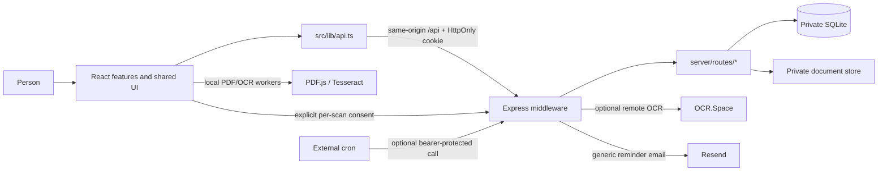

# MediVault

MediVault is a personal health workspace for organizing medical documents and
medication schedules in one private account. It is a full-stack portfolio/MVP
project built around clear data ownership, explicit medication check-ins, and
reviewable links between a prescription record and the medication entered from
it.

> **Live demo:** [medivault-dlq9.onrender.com](https://medivault-dlq9.onrender.com)
>
> The demo is for fictional data only. Do not enter real health information.
> Its free hosted instance may take time to wake up.

## What it does

- **Medication workspace:** create and edit medications, view a daily schedule,
  record taken/skipped outcomes, browse history, and see an adherence summary.
- **Medical records vault:** upload, search, categorize, preview, download, and
  delete private PDF/JPG/PNG documents, grouped by family profile, optional care
  track, and dated visit.
- **Family profiles:** organize each managed person's medical records and
  medication schedule under the account owner's login.
- **Visit-centered timeline:** group related visits under owner-created care
  tracks; standalone visits and unassigned documents remain easy to find.
- **Prescription-to-medication link:** keep the source record and reviewed
  prescription wording attached to a medication.
- **Review-first prescription OCR:** local browser OCR is the default. An
  optional, server-configured OCR.Space path requires consent for each scan;
  results remain editable and must be checked before saving.
- **Optional email reminders:** an opted-in account can receive generic dose
  reminders when Resend credentials and an external scheduler are configured.
  Delivery is best-effort, not a clinical or emergency alert.
- **Health profile and dashboard:** manage profile details and see a
  database-backed overview of records, medications, and today's schedule.
- **Settings:** change appearance, update a password, export account data, and
  create an optional private activity summary.

Family profiles are owner-managed and do not have separate logins or delegated
access. Email reminders and remote OCR are optional integrations and are not
available unless an operator configures them. The public demo is for fictional
data only; never send real or sensitive medical documents to the optional OCR
provider. MediVault does not connect to a clinic/EHR or provide AI-generated
medical advice. A scheduled dose is not proof that a dose was taken or missed;
users record outcomes explicitly.

The former health-measurement tracker is not an active product/API feature.
Existing historical measurements are preserved in SQLite and included only in
the owner's full account export.

## Technology

| Area                | Technology                                                                    |
| ------------------- | ----------------------------------------------------------------------------- |
| Frontend            | React, TypeScript, Vite, React Router                                         |
| UI                  | Tailwind CSS, Base UI/shadcn-style primitives, Lucide                         |
| Forms and contracts | React Hook Form, Zod                                                          |
| Backend             | Node.js, Express 5, same-origin JSON/multipart API                            |
| Database            | SQLite via Node's built-in `node:sqlite`, migrations and foreign keys         |
| Documents           | Private local storage or an S3-compatible object store                        |
| OCR/PDF             | Local Tesseract.js/PDF.js; optional consent-gated OCR.Space processing        |
| Email reminders     | Optional Resend API integration with an external scheduler                    |
| Hosting example     | Render container, with Litestream SQLite replication and private B2 documents |

This repository currently uses **Express and SQLite**, not Supabase. The
architecture keeps the browser, API, database, and document access in clear
boundaries without requiring a separately operated database service.

## How the application fits together



The frontend validates forms for usability, while the API validates requests
again and checks ownership before reading or changing private data. Production
serves the built frontend and API from the same Express application. See the
[architecture and module map](docs/architecture.md),
[end-to-end system guide](docs/system-overview.md), and
[request-flow guide](docs/flows.md).

## Run locally

Requirements: Node.js **22.18 or newer** and npm.

```powershell
npm ci
npm run dev
```

Open <http://127.0.0.1:5187>, create a fictional account, and use the app. The
development launcher starts Vite and Express together and checks API readiness.
By default, runtime data is stored locally:

- `data/medivault.sqlite` (plus SQLite WAL/SHM files while running)
- `data/documents/<user-id>/<random-file-name>`

The `data/` directory is ignored by Git and must not be deleted to restart the
server. Use a protected local directory and fictional data for development.

Optional settings are documented in [.env.example](.env.example). Never put
server credentials in a `VITE_` variable or commit a populated `.env` file.
Remote OCR is disabled by default and should not receive real medical
documents. Email reminders require all three `RESEND_API_KEY`, `EMAIL_FROM`,
and `REMINDER_CRON_SECRET` values plus an external scheduler calling
`POST /api/internal/reminders` regularly. See the [request flow guide](docs/flows.md)
for consent, message content, authorization, and delivery limitations.

## Repository map

```text
src/
  components/       shared layout and accessible UI primitives
  contexts/         authentication and loaded-vault state
  features/         auth, dashboard, medications, records, profile, settings
  hooks/            shared mutation and query-state helpers
  lib/              API client, theme, navigation and shared UI utilities
shared/             types, Zod schemas and client/server contracts
server/
  routes/           auth, vault, care, records, medications and reminders
  migrations/       versioned SQLite schema changes (currently v6)
docs/               architecture, flows, decisions, operations and development
```

Feature-specific pages, components, and domain helpers live together under
`src/features/<feature>/`. Server route modules are composed by
[`server/app.ts`](server/app.ts); reusable request/session/ownership behavior
lives in [`server/routes/context.ts`](server/routes/context.ts). Historical
health-measurement rows from the retired tracker remain in the database and
account export; there is no active tracker UI or metrics API.

## Build and verification

```powershell
npm run typecheck
npm run verify
```

`npm run verify` checks formatting, lint, production build, and emitted runtime
assets. Automated test suites are intentionally local-only and are not included
in the published repository; see the [development guide](docs/development.md)
for the exact verification boundary.

## Security and project limits

- Passwords are hashed; the browser receives an HttpOnly session cookie.
- User-owned rows are scoped by the authenticated account in the API.
- Medical documents are stored outside the public frontend and streamed only
  after an authenticated ownership check.
- SQLite and documents are **not application-encrypted at rest**. Protect the
  host storage and use fictional data in the public demo.
- MediVault is an educational portfolio project, not a medical device, care
  provider, or HIPAA-compliance claim. It does not diagnose, prescribe, or
  recommend treatment.

## Documentation

- [Architecture and module map](docs/architecture.md)
- [System integration and production runtime](docs/system-overview.md)
- [Data contracts and API request flows](docs/flows.md)
- [Product landscape and staged roadmap](docs/product-roadmap.md)
- [Engineering decisions](docs/decisions.md)
- [Development and release](docs/development.md)
- [Operations and recovery](docs/operations.md)

For private, beginner-oriented learning notes, see the locally ignored
[`personal-learning/`](personal-learning/) folder. Its contents are not
published to GitHub.
