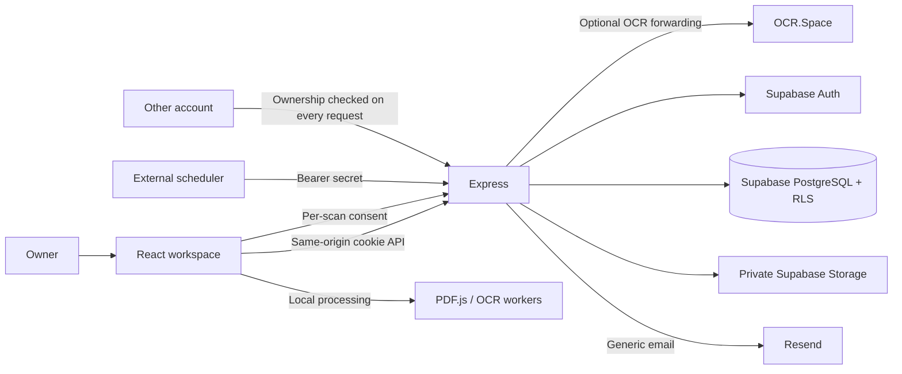
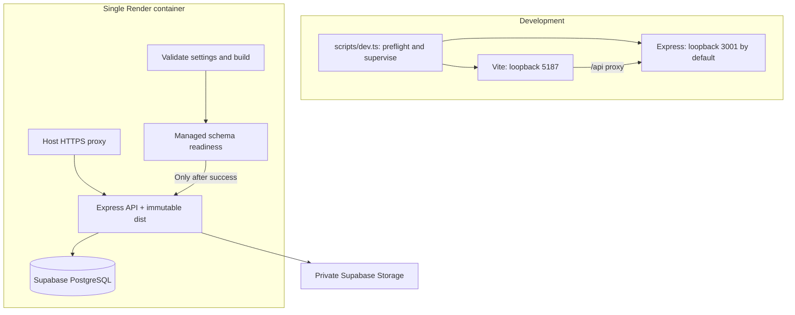
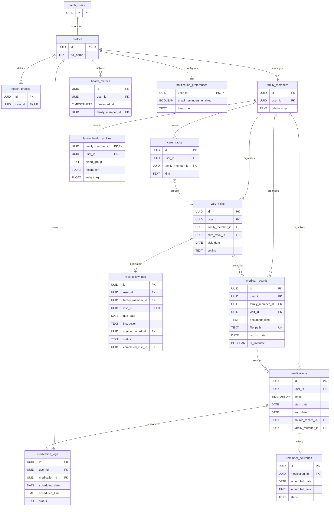

# Technical Architecture and Module Map

## Context and stack

MediVault is a same-origin modular monolith: one React application and one Express
process, with Supabase Auth, PostgreSQL and private Storage. The primary workflows organize
existing prescriptions, explicitly record outcomes, and manage medical documents.
The retired measurement UI is not a missing dashboard feature: compatibility APIs
and JSON export retain earlier measurements.

The server validates Supabase sessions, then uses a request-scoped user client
for ordinary PostgreSQL reads and writes. The server-only secret client handles
validated object mutations, schema readiness and optional reminder-worker RPCs.

| Layer            | Technology and reason                                                                                                  |
| ---------------- | ---------------------------------------------------------------------------------------------------------------------- |
| Browser          | React, TypeScript, React Router and lazy pages: typed interactive workflows without loading OCR on sign-in.            |
| Presentation     | Tailwind, shadcn/Base UI, Geist and Lucide: shared tokens, accessible primitives and consistent controls.              |
| Forms/contracts  | React Hook Form and shared Zod schemas: client guidance plus authoritative server validation and validated responses.  |
| Application      | Express on Node 24 LTS (minimum 22.18): serves API and production frontend together.                                   |
| Database         | Supabase PostgreSQL with owner-scoped RLS, composite foreign keys and versioned migrations.                            |
| Files            | Private Supabase Storage; bytes are delivered only through authenticated API requests.                                 |
| Document reading | PDF.js and Tesseract run locally by default; optional OCR.Space processing is server-keyed and consent-gated per scan. |
| Email reminders  | Optional Resend delivery from a bearer-protected scheduler endpoint, disabled until configured.                        |
| Verification     | Vitest, Testing Library, Supertest, startup/build checks; see [workflow](development.md) for what each proves.         |

OCR workers are browser processes. API ownership checks and PostgreSQL RLS
independently restrict ordinary data access; secret clients are server-only.

## Runtime and deployment

Host filesystem replacement does not erase managed data. API readiness probes
the managed schema, not Auth, document availability or backup recoverability.
Files and database changes cannot commit atomically.
See [flow failure branches](flows.md#documents).

## Managed PostgreSQL schema

The authoritative schema and guards are in
[Supabase migrations](../supabase/migrations), including the account aggregate
and reminder-worker functions.
Supabase Auth owns credentials and sessions; application tables contain no
password or session material. Applying these migrations creates no legacy users
or healthcare data. Fresh Auth accounts receive one `profiles` row, one `self`
family member (`id = user_id`) and default-off notification preferences from a
transactional Auth trigger.

Exposed healthcare tables have RLS enabled and explicit least-privilege grants.
Anonymous requests have no public-schema/table access; authenticated requests
are owner-filtered, with resulting-row owner checks for writes. `profiles` is
read-only to its owner, while `health_metrics` is select-only because its UI and
mutation API are retired. `reminder_deliveries` has no ordinary-user grants and
an explicit deny policy. The Auth bootstrap function is in the unexposed
`private` schema, has a fixed search path and does not inherit default PUBLIC
execution. The server secret key is not used for ordinary owner CRUD.

`get_account_vault_data` and `get_account_export_data` are SECURITY INVOKER
functions. They derive the owner from `auth.uid()`, rely on the same table grants
and RLS as direct reads, and return deterministically ordered JSON aggregates in
one row so large collections are not truncated by the Data API row limit. Their
typed result contracts preserve nulls, numeric/boolean values, date-only fields
and `HH:mm` schedule times.

`get_due_reminder_candidates`, `claim_reminder_delivery` and
`complete_reminder_delivery` are SECURITY DEFINER worker functions with an empty
search path. Their EXECUTE grants are revoked from PUBLIC, `anon` and
`authenticated`, and granted only to `service_role`; the underlying
`reminder_deliveries` table remains unavailable to ordinary users. Candidate
results contain owner IDs and dose coordinates, not recipient addresses. Claims
recheck consent, schedule and unlogged-dose conditions, use the unique dose
coordinate for atomic duplicate prevention, and permit retry only after the
55-second lease expires. Completion compares the claim timestamp so a stale
worker cannot overwrite a newer attempt. The service key and Auth recipient
lookup remain server-only; no scheduler or live email delivery is enabled by
these schema changes.

UUID composite foreign keys bind records, medications, logs, tracks, visits and
follow-ups to the same account and family profile. A medication retains a native
PostgreSQL time array and date-only treatment dates; outcomes have a unique
`(medication_id, scheduled_date, scheduled_time)` coordinate. The database
preserves visit/document/source relationships and optional follow-up links.
Transactional dose, profile-name and follow-up guards are enforced by the
versioned migrations. Hosted acceptance remains separate from local build and
real-provider API verification.

The retired `health_metrics` relation remains owner-scoped for account export
compatibility but starts empty. Family profiles organize data; they are not
separate identities or grants. Care tracks and visits remain optional
organizational context, and deleting them must not cascade through clinical data.

Each actual visit owns at most one optional `visit_follow_ups` row. Follow-ups
store a manually selected due date, original instruction, optional source
document from that visit, pending/completed/cancelled status and optional actual
return visit. All links share the owner and family profile. Return visits must
be different and on/after the origin; due dates cannot precede the origin.
Origin deletion cascades the follow-up. Source or return deletion clears only
that link, preserving wording, date and asserted status. Record reassignment
clears its source link in the same SQL statement; invalidating visit edits are
rejected. Migration creates no follow-ups for old visits.

Medical records is the compact actual-visit/document workspace. The separate
protected `/medical-history` page reuses the care graph and the same selected
profile's vault data; Health profile remains personal health details. Shared
navigation/palette include history above Profile, while the mobile dock selects
its four existing destinations explicitly. No graph runtime or duplicate
history table is introduced. Full-vault fetching remains unpaginated.
Deleting an otherwise empty non-owner profile removes its demographic and
family health-profile details. The account owner's personal details remain in
`health_profiles`; other family members' health details are stored one-to-one
in `family_health_profiles`.
Care tracks and visits are optional organizational context, not inferred
clinical relationships. Track/visit and visit/document associations must stay
within the same account and family profile. Deleting a visit unassigns its
documents; deleting a track leaves its visits standalone.
Favourites are PostgreSQL booleans and strict booleans in
API responses. They live on the owned record, not in a separate achievement or
bookmark table.

## Responsibility map

| Module                                                                                                                                                                                                   | Responsibility / invariant                                                                                               |
| -------------------------------------------------------------------------------------------------------------------------------------------------------------------------------------------------------- | ------------------------------------------------------------------------------------------------------------------------ |
| [api](../src/lib/api.ts), [shared contracts](../shared/contracts.ts), [shared schemas](../shared/schemas.ts), [shared types](../shared/database.types.ts), [document validation](../shared/documents.ts) | Same-origin client, response/request validation, domain types and shared file validation; never browser database access. |
| [shared health helpers](../shared/health.ts), [utilities](../src/lib/utils.ts), [theme](../src/lib/theme.ts), [navigation](../src/lib/navigation.ts)                                                     | Cross-feature date helpers, formatting, appearance preference and shared destinations.                                   |
| [auth feature](../src/features/auth), [dashboard feature](../src/features/dashboard), [profile feature](../src/features/profile), [settings feature](../src/features/settings)                           | Feature pages and feature-specific presentation; dashboard also owns visualization/summary helpers.                      |
| [medications feature](../src/features/medications), [records feature](../src/features/records)                                                                                                           | Feature pages, components and domain helpers grouped by workflow; local OCR/PDF processing remains in records.           |
| [demo data](../src/features/demo/sampleData.ts)                                                                                                                                                          | Explicit fictional seeding, separate from private runtime database/document storage.                                     |
| [Layout](../src/components/Layout.tsx), [CommandPalette](../src/components/CommandPalette.tsx), [ThemeSelect](../src/components/ThemeSelect.tsx)                                                         | Responsive navigation/action discovery and shared appearance controls.                                                   |
| [common](../src/components/common.tsx), [UI primitives](../src/components/ui), [CSS](../src/index.css)                                                                                                   | Loading/empty/form/dialog conventions, accessible controls, design tokens and bounded visual effects.                    |
| [App](../src/App.tsx), [main](../src/main.tsx)                                                                                                                                                           | Provider/router boundaries, lazy feature routes, signed-in/out access; legacy tracker redirect.                          |
| [AuthProvider](../src/contexts/AuthProvider.tsx), [AuthContext](../src/contexts/AuthContext.ts)                                                                                                          | Session lifecycle, request generations, sign-in/up/out, expiry and focus refresh.                                        |
| [DataProvider](../src/contexts/DataProvider.tsx), [DataContext](../src/contexts/DataContext.ts)                                                                                                          | Owned dataset and clock; minute/focus refresh, stale data and late-response invalidation.                                |
| [useMutation](../src/hooks/useMutation.ts), [useQueryParams](../src/hooks/useQueryParams.ts)                                                                                                             | Pending/error/save refresh pattern; explicit URL query updates.                                                          |
| [app](../server/app.ts)                                                                                                                                                                                  | Express setup, security/request middleware, authentication boundary, static frontend and centralized error handling.     |
| [auth routes](../server/routes/auth.ts), [route context](../server/routes/context.ts)                                                                                                                    | Public auth and password routes; shared validation, session, ownership and CRUD helpers.                                 |
| [vault routes](../server/routes/vault.ts), [care routes](../server/routes/care.ts)                                                                                                                       | Owned vault/profile endpoints and profile-scoped care tracks/visits.                                                     |
| [record routes](../server/routes/records.ts), [medication routes](../server/routes/medications.ts)                                                                                                       | Owner-scoped private document operations, opt-in OCR forwarding, medication CRUD and explicit dose logs.                 |
| [notification routes](../server/routes/notifications.ts)                                                                                                                                                 | Reminder preferences and secret-authorized, idempotent scheduled Resend delivery.                                        |
| [Supabase clients](../server/supabase.ts), [generated database types](../server/supabase.types.ts), [managed migrations](../supabase/migrations)                                                         | Typed request/admin client boundaries, PostgreSQL RLS and transactional guards.                                          |
| [config](../server/config.ts), [index](../server/index.ts), [frontend-build](../server/frontend-build.ts)                                                                                                | Validated startup, shutdown and production-artifact refusal before opening storage.                                      |
| [document-store](../server/document-store.ts)                                                                                                                                                            | Private native Supabase put/get/delete interface; injectable failure seam.                                               |
| [dev](../scripts/dev.ts), [dev-runtime](../scripts/dev-runtime.ts)                                                                                                                                       | Check ports, own children, prove direct/proxied readiness, bounded failure/cleanup.                                      |
| [check-build](../scripts/check-build.ts), [ocr-assets](../scripts/ocr-assets.ts)                                                                                                                         | Complete emitted resources/entry budget and locally packaged worker assets.                                              |
| [Release guide](development.md), [CI](../.github/workflows/verify.yml)                                                                                                                                   | Published source/build, image-compilation and audit gates; functional suites remain local-only.                          |

For code navigation, read a page, then its domain helper/client, then the matching
handler and migration. Avoid spreading validation or private file access into
unrelated UI components.
