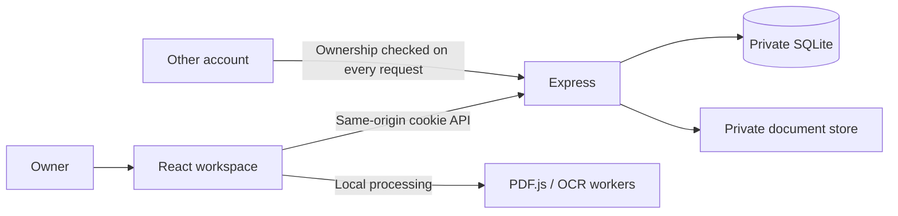
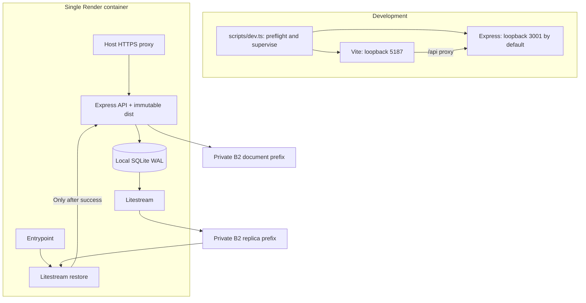
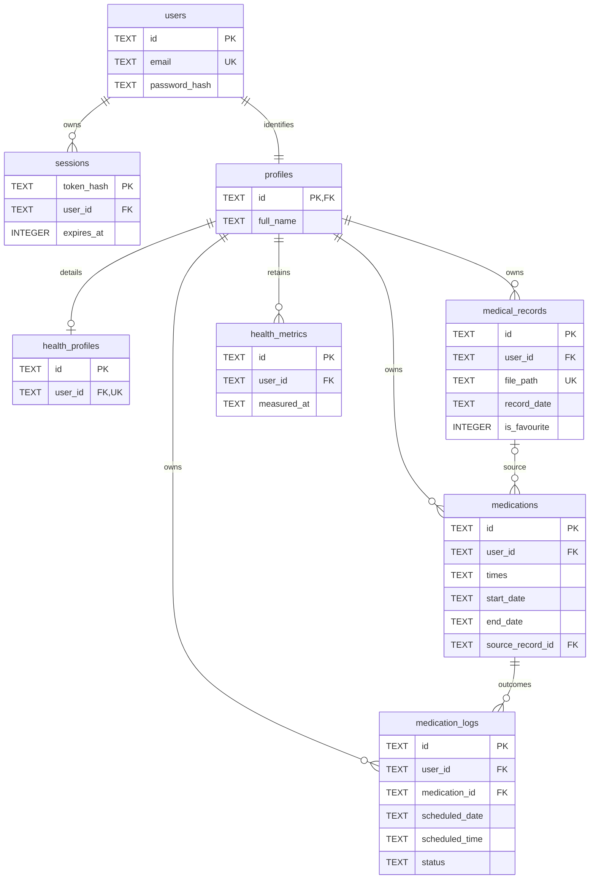

# Technical Architecture and Module Map

## Context and stack

MediVault is a same-origin modular monolith: one React application and one Express
process, with SQLite and a private document store. The primary workflows organize
existing prescriptions, explicitly record outcomes, and manage medical documents.
The retired measurement UI is not a missing dashboard feature: compatibility APIs
and JSON export retain earlier measurements.

| Layer            | Technology and reason                                                                                                                               |
| ---------------- | --------------------------------------------------------------------------------------------------------------------------------------------------- |
| Browser          | React, TypeScript, React Router and lazy pages: typed interactive workflows without loading OCR on sign-in.                                         |
| Presentation     | Tailwind, shadcn/Base UI, Geist and Lucide: shared tokens, accessible primitives and consistent controls.                                           |
| Forms/contracts  | React Hook Form and shared Zod schemas: client guidance plus authoritative server validation and validated responses.                               |
| Application      | Express on Node 24 LTS (minimum 22.18): serves API and production frontend together.                                                                |
| Database         | Node `node:sqlite`, WAL, foreign keys, strict tables and forward SQL migrations: a small single-writer deployment without another database service. |
| Files            | Private local directory or S3-compatible B2 objects: bytes are delivered only through authenticated API requests.                                   |
| Local processing | PDF.js and Tesseract workers/assets served by the application: no external OCR/AI processing.                                                       |
| Verification     | Vitest, Testing Library, Supertest, startup/build checks; see [workflow](development.md) for what each proves.                                      |

Workers are browser processes, not cloud services. SQLite cannot provide
PostgreSQL RLS: API ownership conditions, relational constraints and filesystem
access controls are the relevant boundaries here.

## Runtime and deployment

Run exactly one writer per replica path. Replication's configured ten-second sync
interval is not zero-data-loss backup. API readiness probes SQLite; it does not
prove B2 availability or replica freshness. Files and database changes cannot
commit atomically. See [flow failure branches](flows.md#documents).

## Data model

The diagram omits descriptive fields/timestamps; the authoritative definitions
are [initial migration](../server/migrations/001_initial.sql),
[prescription-link migration](../server/migrations/002_prescription_links.sql)
and [favourites migration](../server/migrations/003_record_favourites.sql).
The application creates `users` and `profiles` together. Outcomes have a unique
`(medication_id, scheduled_date, scheduled_time)` coordinate; a composite
medication/owner foreign key prevents cross-owner logs. Triggers validate times
and source ownership. Deleting a source sets the link to null, while deleting a
medication cascades its logs.
Favourites are constrained integer 0/1 values in SQLite and strict booleans in
API responses. They live on the owned record, not in a separate achievement or
bookmark table.

## Responsibility map

| Module                                                                                                                                                                                                                                         | Responsibility / invariant                                                                                         |
| ---------------------------------------------------------------------------------------------------------------------------------------------------------------------------------------------------------------------------------------------- | ------------------------------------------------------------------------------------------------------------------ |
| [App](../src/App.tsx), [main](../src/main.tsx)                                                                                                                                                                                                 | Provider/router boundaries, lazy routes, signed-in/out access; legacy tracker redirect.                            |
| [AuthProvider](../src/contexts/AuthProvider.tsx), [AuthContext](../src/contexts/AuthContext.ts)                                                                                                                                                | Session lifecycle, request generations, sign-in/up/out, expiry and focus refresh.                                  |
| [DataProvider](../src/contexts/DataProvider.tsx), [DataContext](../src/contexts/DataContext.ts)                                                                                                                                                | Owned dataset and clock; minute/focus refresh, stale data and late-response invalidation.                          |
| [useMutation](../src/hooks/useMutation.ts), [useQueryParams](../src/hooks/useQueryParams.ts)                                                                                                                                                   | Pending/error/save refresh pattern; explicit URL query updates.                                                    |
| [api](../src/lib/api.ts), [contracts](../src/lib/contracts.ts), [schemas](../src/lib/schemas.ts), [database.types](../src/lib/database.types.ts)                                                                                               | Same-origin client, response and request validation, domain types; never browser database access.                  |
| [dashboard](../src/lib/dashboard.ts), [calendar](../src/lib/calendar.ts), [records](../src/lib/records.ts), [utils](../src/lib/utils.ts)                                                                                                       | Testable derivations, local-time projections, discovery/order, document validation and formatters.                 |
| [ocr](../src/lib/ocr.ts), [pdf](../src/lib/pdf.ts), [prescription](../src/lib/prescription.ts)                                                                                                                                                 | Local worker lifecycle, PDF setup, conservative draft extraction; no prescribing.                                  |
| [theme](../src/lib/theme.ts), [navigation](../src/lib/navigation.ts), [sampleData](../src/lib/sampleData.ts)                                                                                                                                   | Appearance preference, shared destinations/actions, explicit fictional seeding.                                    |
| [pages](../src/pages)                                                                                                                                                                                                                          | Auth, dashboard, medications, records, health profile and settings orchestrate existing components and owned data. |
| [Layout](../src/components/Layout.tsx), [CommandPalette](../src/components/CommandPalette.tsx), [ThemeSelect](../src/components/ThemeSelect.tsx)                                                                                               | Responsive navigation/action discovery and shared appearance controls.                                             |
| [DoseSchedule](../src/components/DoseSchedule.tsx), [MedicationCalendar](../src/components/MedicationCalendar.tsx), [MedicationReminder](../src/components/MedicationReminder.tsx), [DashboardVisuals](../src/components/DashboardVisuals.tsx) | Explicit outcomes, read-only projections, website-open check-ins, accessible real-data visuals.                    |
| [MedicationCard](../src/components/MedicationCard.tsx), [MedicationForm](../src/components/MedicationForm.tsx)                                                                                                                                 | Current prescription identity and validated editing; source dates/times are not inferred.                          |
| [MedicalRecordCard](../src/components/MedicalRecordCard.tsx), [UploadDialog](../src/components/UploadDialog.tsx)                                                                                                                               | Owned record identity/actions, confirmed deletion and supported-file upload.                                       |
| [RecordPreview](../src/components/RecordPreview.tsx), [PdfPreview](../src/components/PdfPreview.tsx)                                                                                                                                           | Private fetch/render lifecycle, disposal, retry, page controls, focus/scroll restoration.                          |
| [PrescriptionScanner](../src/components/PrescriptionScanner.tsx)                                                                                                                                                                               | Cancellable scan, editable text and explicitly reviewed medication drafts.                                         |
| [MedicationShowcase](../src/components/MedicationShowcase.tsx), [CSS](../src/index.css)                                                                                                                                                        | Original decorative illustration, pause/static alternatives, tokens and bounded visual effects.                    |
| [common](../src/components/common.tsx), [UI primitives](../src/components/ui)                                                                                                                                                                  | Loading/empty/form/dialog conventions; shared accessible control presentation.                                     |
| [app](../server/app.ts), [auth](../server/auth.ts)                                                                                                                                                                                             | Validated owner-scoped handlers, errors, sessions/password hashing, request protection and private delivery.       |
| [database](../server/database.ts), [migrations](../server/migrations)                                                                                                                                                                          | WAL/foreign keys/migration version, transactional operations and row decoding.                                     |
| [config](../server/config.ts), [index](../server/index.ts), [frontend-build](../server/frontend-build.ts)                                                                                                                                      | Validated startup, shutdown and production-artifact refusal before opening storage.                                |
| [document-store](../server/document-store.ts)                                                                                                                                                                                                  | Private local/S3 put/get/delete interface; injectable failure seam.                                                |
| [dev](../scripts/dev.ts), [dev-runtime](../scripts/dev-runtime.ts)                                                                                                                                                                             | Check ports, own children, prove direct/proxied readiness, bounded failure/cleanup.                                |
| [check-build](../scripts/check-build.ts), [ocr-assets](../scripts/ocr-assets.ts)                                                                                                                                                               | Complete emitted resources/entry budget and locally packaged worker assets.                                        |
| [Release guide](development.md), [CI](../.github/workflows/verify.yml)                                                                                                                                                                         | Published source/build, image-compilation and audit gates; functional suites remain local-only.                    |

For code navigation, read a page, then its domain helper/client, then the matching
handler and migration. Avoid spreading validation or private file access into
unrelated UI components.
