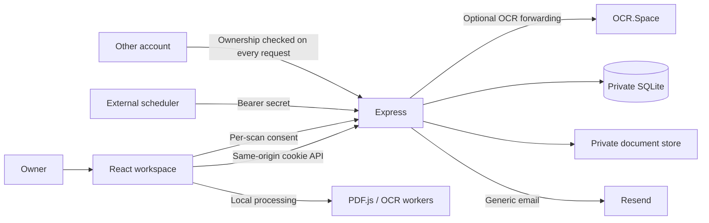
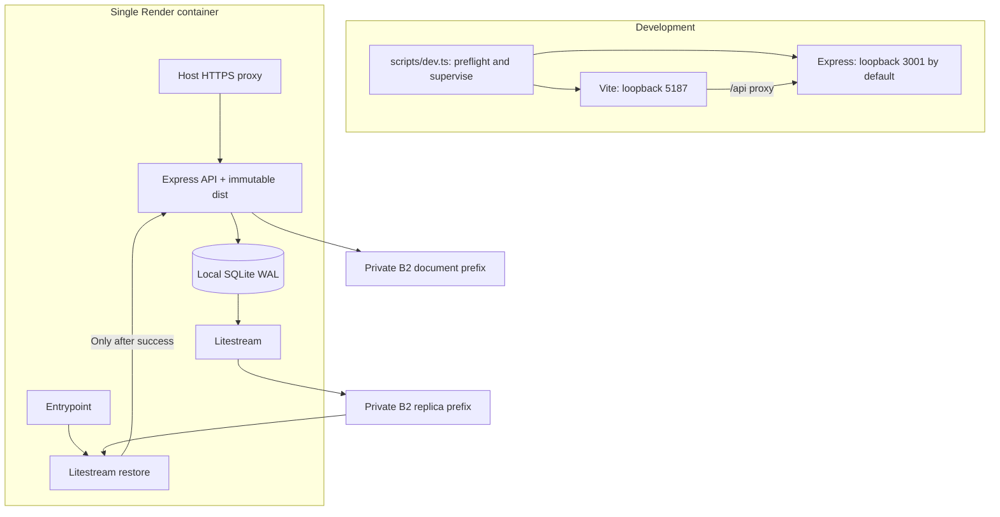
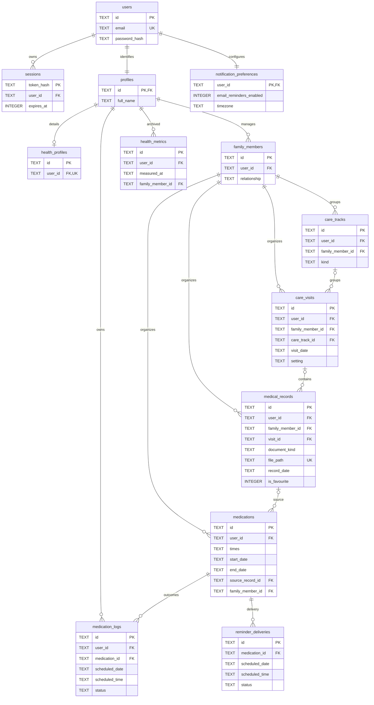

# Technical Architecture and Module Map

## Context and stack

MediVault is a same-origin modular monolith: one React application and one Express
process, with SQLite and a private document store. The primary workflows organize
existing prescriptions, explicitly record outcomes, and manage medical documents.
The retired measurement UI is not a missing dashboard feature: compatibility APIs
and JSON export retain earlier measurements.

| Layer            | Technology and reason                                                                                                                               |
| ---------------- | --------------------------------------------------------------------------------------------------------------------------------------------------- |
| Browser          | React, TypeScript, React Router and lazy pages: typed interactive workflows without loading OCR on sign-in.                                         |
| Presentation     | Tailwind, shadcn/Base UI, Geist and Lucide: shared tokens, accessible primitives and consistent controls.                                           |
| Forms/contracts  | React Hook Form and shared Zod schemas: client guidance plus authoritative server validation and validated responses.                               |
| Application      | Express on Node 24 LTS (minimum 22.18): serves API and production frontend together.                                                                |
| Database         | Node `node:sqlite`, WAL, foreign keys, strict tables and forward SQL migrations: a small single-writer deployment without another database service. |
| Files            | Private local directory or S3-compatible B2 objects: bytes are delivered only through authenticated API requests.                                   |
| Document reading | PDF.js and Tesseract run locally by default; optional OCR.Space processing is server-keyed and consent-gated per scan.                              |
| Email reminders  | Optional Resend delivery from a bearer-protected scheduler endpoint; no provider credentials are needed for local development.                      |
| Verification     | Vitest, Testing Library, Supertest, startup/build checks; see [workflow](development.md) for what each proves.                                      |

Workers are browser processes, not cloud services. SQLite cannot provide
PostgreSQL RLS: API ownership conditions, relational constraints and filesystem
access controls are the relevant boundaries here.

## Runtime and deployment

Run exactly one writer per replica path. Replication's configured ten-second sync
interval is not zero-data-loss backup. API readiness probes SQLite; it does not
prove B2 availability or replica freshness. Files and database changes cannot
commit atomically. See [flow failure branches](flows.md#documents).

## Data model

The diagram omits descriptive fields/timestamps; the authoritative definitions
are [initial migration](../server/migrations/001_initial.sql),
[prescription-link migration](../server/migrations/002_prescription_links.sql)
and [favourites migration](../server/migrations/003_record_favourites.sql),
[family-profile migration](../server/migrations/004_family_members.sql),
[reminder migration](../server/migrations/005_email_reminders.sql), and
[care-organization migration](../server/migrations/006_care_organization.sql).
The current schema version is 6. Existing users' records, medications, and
historical measurements are backfilled to their `self` family profile.
Measurements have no active UI or mutation API; existing rows are retained for
account export. Outcomes have a unique
`(medication_id, scheduled_date, scheduled_time)` coordinate; a composite
medication/owner foreign key prevents cross-owner logs. Triggers validate times
and source ownership. A prescription source must belong to the same account and
family profile as its medication. Family profiles organize records and do not
grant separate identities or access. Deleting a source sets the link to null,
while deleting a medication cascades its logs.
Only empty non-owner family profiles can be deleted. The API checks all
profile-owned data in a transaction and returns a conflict rather than
cascade-deleting it; archived historical measurements also prevent deletion.
Care tracks and visits are optional organizational context, not inferred
clinical relationships. Track/visit and visit/document associations must stay
within the same account and family profile. Deleting a visit unassigns its
documents; deleting a track leaves its visits standalone.
Favourites are constrained integer 0/1 values in SQLite and strict booleans in
API responses. They live on the owned record, not in a separate achievement or
bookmark table.

## Responsibility map

| Module                                                                                                                                                                                                   | Responsibility / invariant                                                                                               |
| -------------------------------------------------------------------------------------------------------------------------------------------------------------------------------------------------------- | ------------------------------------------------------------------------------------------------------------------------ |
| [api](../src/lib/api.ts), [shared contracts](../shared/contracts.ts), [shared schemas](../shared/schemas.ts), [shared types](../shared/database.types.ts), [document validation](../shared/documents.ts) | Same-origin client, response/request validation, domain types and shared file validation; never browser database access. |
| [shared health helpers](../shared/health.ts), [utilities](../src/lib/utils.ts), [theme](../src/lib/theme.ts), [navigation](../src/lib/navigation.ts)                                                     | Cross-feature date helpers, formatting, appearance preference and shared destinations.                                   |
| [auth feature](../src/features/auth), [dashboard feature](../src/features/dashboard), [profile feature](../src/features/profile), [settings feature](../src/features/settings)                           | Feature pages and feature-specific presentation; dashboard also owns visualization/summary helpers.                      |
| [medications feature](../src/features/medications), [records feature](../src/features/records)                                                                                                           | Feature pages, components and domain helpers grouped by workflow; local OCR/PDF processing remains in records.           |
| [demo data](../src/features/demo/sampleData.ts)                                                                                                                                                          | Explicit fictional seeding, separate from private runtime database/document storage.                                     |
| [Layout](../src/components/Layout.tsx), [CommandPalette](../src/components/CommandPalette.tsx), [ThemeSelect](../src/components/ThemeSelect.tsx)                                                         | Responsive navigation/action discovery and shared appearance controls.                                                   |
| [common](../src/components/common.tsx), [UI primitives](../src/components/ui), [CSS](../src/index.css)                                                                                                   | Loading/empty/form/dialog conventions, accessible controls, design tokens and bounded visual effects.                    |
| [App](../src/App.tsx), [main](../src/main.tsx)                                                                                                                                                           | Provider/router boundaries, lazy feature routes, signed-in/out access; legacy tracker redirect.                          |
| [AuthProvider](../src/contexts/AuthProvider.tsx), [AuthContext](../src/contexts/AuthContext.ts)                                                                                                          | Session lifecycle, request generations, sign-in/up/out, expiry and focus refresh.                                        |
| [DataProvider](../src/contexts/DataProvider.tsx), [DataContext](../src/contexts/DataContext.ts)                                                                                                          | Owned dataset and clock; minute/focus refresh, stale data and late-response invalidation.                                |
| [useMutation](../src/hooks/useMutation.ts), [useQueryParams](../src/hooks/useQueryParams.ts)                                                                                                             | Pending/error/save refresh pattern; explicit URL query updates.                                                          |
| [app](../server/app.ts)                                                                                                                                                                                  | Express setup, security/request middleware, authentication boundary, static frontend and centralized error handling.     |
| [auth routes](../server/routes/auth.ts), [route context](../server/routes/context.ts)                                                                                                                    | Public auth and password routes; shared validation, session, ownership and CRUD helpers.                                 |
| [vault routes](../server/routes/vault.ts), [care routes](../server/routes/care.ts)                                                                                                                       | Owned vault/profile endpoints and profile-scoped care tracks/visits.                                                     |
| [record routes](../server/routes/records.ts), [medication routes](../server/routes/medications.ts)                                                                                                       | Owner-scoped private document operations, opt-in OCR forwarding, medication CRUD and explicit dose logs.                 |
| [notification routes](../server/routes/notifications.ts)                                                                                                                                                 | Reminder preferences and secret-authorized, idempotent scheduled Resend delivery.                                        |
| [database](../server/database.ts), [migrations](../server/migrations)                                                                                                                                    | WAL/foreign keys/migration version, transactional operations and row decoding.                                           |
| [config](../server/config.ts), [index](../server/index.ts), [frontend-build](../server/frontend-build.ts)                                                                                                | Validated startup, shutdown and production-artifact refusal before opening storage.                                      |
| [document-store](../server/document-store.ts)                                                                                                                                                            | Private local/S3 put/get/delete interface; injectable failure seam.                                                      |
| [dev](../scripts/dev.ts), [dev-runtime](../scripts/dev-runtime.ts)                                                                                                                                       | Check ports, own children, prove direct/proxied readiness, bounded failure/cleanup.                                      |
| [check-build](../scripts/check-build.ts), [ocr-assets](../scripts/ocr-assets.ts)                                                                                                                         | Complete emitted resources/entry budget and locally packaged worker assets.                                              |
| [Release guide](development.md), [CI](../.github/workflows/verify.yml)                                                                                                                                   | Published source/build, image-compilation and audit gates; functional suites remain local-only.                          |

For code navigation, read a page, then its domain helper/client, then the matching
handler and migration. Avoid spreading validation or private file access into
unrelated UI components.
