# Development and Release Guide

## Setup

Use Node 24 LTS (minimum 22.18), the committed npm lockfile and an explicitly
configured Supabase project or isolated local Supabase stack.

Windows:

```powershell
Set-Location C:\Project
npm ci
npm run dev
```

POSIX, from your checkout:

```sh
npm ci
npm run dev
```

Open `http://127.0.0.1:5187` after **MediVault ready**. The launcher checks both API
and frontend ports and verifies direct/proxied health. Stop it with Ctrl+C in its
own terminal before reinstalling dependencies, especially on Windows.

Copy [.env.example](../.env.example) to `.env` and supply the Supabase settings,
or provide them through the process environment. Never put secrets into `VITE_`
variables, committed files or test fixtures. There is no local persistence
fallback; do not delete old local storage to fix a port conflict.

### Supabase server configuration

The managed-backend migration uses `SUPABASE_URL`,
`SUPABASE_PUBLISHABLE_KEY`, `SUPABASE_SECRET_KEY`, and
`SUPABASE_DOCUMENT_BUCKET`. These are server settings: do not prefix them with
`VITE_`, expose them in browser code, or commit a populated environment file.
Production also requires an HTTPS `APP_ORIGIN` and `COOKIE_SECURE=true`;
development may use an explicitly configured HTTP loopback origin such as
`http://127.0.0.1:5187`. Apply [managed migrations](../supabase/migrations) once
before starting. Startup verifies the remote schema within a bounded request
without running migrations or importing old data.

For email confirmation, configure Supabase **Authentication → URL Configuration**
with the deployed `APP_ORIGIN` as the Site URL and the exact callback URL
`<APP_ORIGIN>/api/auth/callback` in Redirect URLs. For local Vite development,
allowlist only the loopback callback URLs you actually use, such as
`http://127.0.0.1:5187/api/auth/callback`. Avoid broad production wildcards.
Confirmation links use PKCE, expire quickly, and can only be exchanged once;
open the link in the same browser and device where registration began.

This is a fresh account system: existing SQLite accounts and passwords are not
imported. Returning users must register again in the Supabase-backed release;
failed old logins do not create accounts automatically. When confirmation is
required, MediVault explains the pending state without claiming that Supabase
delivered an email. Check the configured sender and project Auth settings if a
message does not arrive.

Automated test suites and their toolchain are not distributed with this
repository. Do not assume a clean checkout contains a runnable integration
harness. Any privately maintained integration checks must target a separately
authorized, isolated project with disposable fictional data, never a project
containing data that must be retained. Verify signup/confirmation separately
with an owner-controlled mailbox.

### Shared form layout

Use the shared `Field`, `SelectField` and `TextField` wrappers for labeled
controls. Their grid gaps space only in-flow content: do not replace them with
sibling margins, because Base UI selects also render an out-of-flow hidden input.
Inputs and selects default to 44px; utilities can explicitly request another
size, such as the records toolbar's 48px controls.

Use `aligned-fields` on multi-column grids of these wrappers when labels can
wrap. Its shared label/control/help tracks keep controls aligned without moving
errors or hints away from their own fields. Typed dates retain a fieldset and
legend; do not hide their labels by removing the accessible association.
Medication start and optional end dates use the shared day/month/year `DateField`,
matching document uploads instead of opening a browser-native calendar popup.

`FormDialog` accepts a caller-specific `className` for larger workspaces while
ordinary forms keep their compact default. Report review and prescription
scanning use wide dialogs: source text and review entry sit side by side from
1024px, stacking on smaller screens. Their extracted-text areas have bounded,
internally scrollable heights; long reports must not stretch them to the full
document length.

The desktop dashboard keeps daily context and upcoming doses beside the main
workspace in a flexible column at least 360px wide. Weekly activity uses a
separate full-width row instead of extending that sidebar. Within the activity
card, the weekly chart and logging summaries sit side by side from 900px and
stack on smaller screens.

Verify actual control tops, bottoms and heights, not just page overflow. Check
320, 390, 768, 1440 and wide desktop layouts in both themes, with long text,
validation messages and open dropdowns. Intentional calendar scrolling must keep
every date reachable without widening the page.

### Record upload limits

The multipart parser derives its text-field limit from the shared record schema
and allows one additional part for the file. The combined Hospital / Doctor form
sends six text fields. Deriving the limit prevents future schema/parser drift,
such as the seven-field regression introduced by the reverted split. Keep strict
metadata validation, the single-file limit, the 10 MB file limit and bounded field sizes enabled; do not
raise limits arbitrarily to work around an upload failure.

### Report-result suggestions

Prescription suggestions support form-first medicine entries and name-first spray
products directly followed by an explicit spray dose. Only complete, simple
once-daily, twice-daily or three-times-daily instructions prefill frequency;
conditional or abbreviated regimens remain custom. No dates or dose times are
inferred. These bounded patterns are not a general prescription interpreter:
unrecognized text requires manual entry and every suggestion requires review
against the original before saving.

The local parser requires explicit supported labels and units. It also accepts
a label, value and unit on three consecutive extracted lines, as produced by
some text-based PDFs. It does not search arbitrarily distant text for a unit,
convert pounds to kilograms or infer a measurement date. Review suggestions
and the report's actual measurement date before saving.

Use a fictional account and manually uploaded test documents for rehearsal.
Do not use production accounts or the public demo as a test environment.

### Source-attributed local demo examples

The retained development fixtures use watermarked PDF examples based on the informative HL7 FHIR R4
[CBC DiagnosticReport](https://hl7.org/fhir/R4/diagnosticreport-example.json.html)
and [Azithromycin MedicationRequest](https://hl7.org/fhir/R4/medicationrequest0302.json.html)
examples. The files are generated for readable upload/OCR rehearsal from the
published example content; they are not original patient documents, valid
prescriptions, diagnoses, or medical advice.

Settings no longer exposes sample-data creation or the informational Privacy
essentials panel. Existing records and privacy protections are unchanged, and
the export warning remains visible. Create isolated test accounts through normal
registration and add fictional profiles and documents manually; no reusable
login credentials are seeded. Staged prescription instructions must not be
reduced to one repeating schedule for a demo.

## Lightweight SDLC

This project uses an iterative/incremental workflow with explicit verification
links, not an invented enterprise process:

```mermaid
flowchart LR
  Need["User need / defect evidence"] --> Scope["Proposal + acceptance scenarios"]
  Scope --> Design["Trade-offs + migration + failure design"]
  Design --> Slice["Small typed implementation slice"]
  Slice --> Evidence["Focused acceptance evidence + related docs"]
  Evidence --> Gates["Production source/build gates"]
  Gates --> Review["Review evidence and limitations"]
  Review --> Release["Explicitly authorized release"]
  Release --> Observe["Observe / recovery rehearsal"]
  Observe --> Need
```



1. Read the relevant module, schema and documented behavior before editing.
2. Record material behavior decisions and rejected alternatives. Reuse shared
   validation/helpers instead of duplicating them in pages or handlers.
3. Implement a coherent slice, including acceptance evidence and related documentation.
   Comment non-obvious invariants, not self-explanatory assignments.
4. Link acceptance scenarios to actual command/API/browser evidence. This
   V-style traceability is useful; adopting a heavyweight formal V-model is not
   required.
5. Run narrow checks first, then integrated gates. Never mark a checkbox complete
   because a control merely renders or a mocked response says success.
6. Review privacy, migration compatibility, failure semantics and retained UX.
   Do not bundle unrelated repairs or suppress failing assertions.
7. Release/deploy only when explicitly requested. Keep a recoverable, compatible
   rollback path; forward schema versions cannot be blindly downgraded.

## Reading and documenting the source

For a newcomer, follow one user action instead of reading every file at once:

1. Start with the [screen tour](system-overview.md#workspace-screen-tour).
2. Read its feature page, for example [ProfilePage](../src/features/profile/pages/ProfilePage.tsx).
3. Follow `useVault` to [DataProvider](../src/contexts/DataProvider.tsx), or a save
   to [useMutation](../src/hooks/useMutation.ts) and the [API client](../src/lib/api.ts).
4. Follow the endpoint to [vault routes](../server/routes/vault.ts), then inspect
   [shared validation](../shared/schemas.ts) and
   [background compatibility](../shared/medical-background.ts).
5. Consult the matching [migration](../supabase/migrations) for database
   constraints, ownership and transactional behavior. TypeScript alone cannot
   enforce those database invariants.

### Commenting conventions

- Begin handwritten modules with a short responsibility comment: what the file
  owns, its important boundary, and any easily confused limitation.
- Use JSDoc above meaningful components, public helpers, hooks and workflow
  handlers. Explain their responsibility, invariants and important failure or
  cleanup behavior. Editors then show this context on hover.
- Let TypeScript describe ordinary parameter/return shapes. Add prose for
  non-obvious contracts: for example, mutation success describes the write,
  while a subsequent refresh can fail separately.
- Explain **why** an inline guard, compatibility path or cleanup exists.
  Stale-response generations, preserved legacy profile text, private-object
  compensation and cancellation are worth documenting.
- Avoid narrating assignments, every JSX element, trivial wrapper functions or
  every inline callback. Presentation-only primitives share a file-level
  contract rather than dozens of identical comments.
- Update comments with behavior; stale prose is a defect. Do not copy credentials,
  personal data or debugging dumps into comments. Do not hand-rewrite generated
  schema sections or historical applied migrations for stylistic consistency.

The public [architecture map](architecture.md#responsibility-map) explains
cross-module ownership; comments explain the nearby implementation. Keep both
aligned when a feature changes.

## Error-handling conventions

| Boundary                              | Responsibility                                                                                                    |
| ------------------------------------- | ----------------------------------------------------------------------------------------------------------------- |
| Form + shared Zod schema              | Show useful field errors and reject invalid values; frontend checks are not authorization.                        |
| Express route/context                 | Revalidate input and ownership, classify expected failures with `HttpError`, and validate returned rows.          |
| API client                            | Reject non-success status, unexpected content type or invalid response shape; retain optional stable error codes. |
| Mutation/form owner                   | Show pending state and explicit failure, prevent duplicate writes, and close/reset only after success.            |
| Data provider + Layout                | Ignore superseded responses and show retained data as stale after refresh failure, never as freshly fetched.      |
| Render boundary                       | Recover from component-render exceptions; async effects and event handlers still need their own error paths.      |
| Document route + app error middleware | Report storage/metadata partial failures and record sanitized incident metadata without raw provider errors.      |

Catch an exception only to translate it, add recovery/cleanup, expose an error,
or handle deliberate cancellation. Do not silently substitute empty clinical
data, pretend an unavailable service succeeded, or automatically retry a write
that may already have committed.

Some operations have explicit partial-success semantics: a password may change
before other-session revocation fails; a document object may be removed before
metadata deletion fails. Preserve that distinction in the user message and
recovery instructions. `DataProvider.reload` reports errors through context;
it does not throw them back as evidence that the earlier write failed.

Keep logs privacy-safe. The server document boundary records an operation,
record ID and incident ID, not file contents, storage paths, access tokens or
raw provider/SQL responses. Do not add blanket `console.error(error)` logging
to every layer or log passwords/form payloads. Expected field errors belong
in UI feedback rather than duplicated infrastructure logs.

## Current verification commands

```sh
npm run format:check
npm run lint
npm run typecheck
npm run build
npm run check:build
npm run verify
npm audit --omit=dev
```

`verify` runs formatting, warning-free lint, strict application/server/build-tool
type checking and the production build, then emitted-resource checks. It stops
at the first failed stage. The entry budget remains 500,000 minified bytes;
OCR workers, language data and PDF resources must all be present.

CI runs the same contract on Node 24 for Windows and Linux, compiles the deployment
image on Linux and separately audits production dependencies. These checks do
**not** establish working browser journeys, runtime container health or backup
durability. Hosted outcomes require an actual published run.

### Publication boundary and reduced assurance

At the owner's request, automated suites, fixtures, runners and test-only
dependencies/configuration are not distributed. There is no published test or
full-browser verification command. Historical local results are not current CI
coverage. Build/audit gates are not substitutes for functional/browser checks.

Private suites/configuration may be retained under an ignored local folder,
but their dependencies and continued compatibility are not guaranteed. Do not
force-add them, embed executable suites in documentation, or upload private
reports. Optional assistant tooling, personal learning notes, demo documents
and OpenSpec planning history are also local-only; none is a build prerequisite.

Before release, rehearse core workflows with an isolated fictional account,
including invalid inputs, retry paths, private document access, reload
persistence, keyboard use and narrow layouts. Record what actually ran and what
did not. Use [operations guidance](operations.md) for separately authorized
container/runtime and real-provider recovery acceptance.

Never rebuild a `dist` currently being served for acceptance: stale hashed imports
can cause MIME/lazy-load failures. Stop only the owned preview first.

## Rehearsing logged-day behavior

Use only a fictional account. After optional sample seeding, open Today and find
the secondary **Lifetime logged days** section. Multiple outcomes for one original
scheduled date count once; taken and skipped contribute equally. Milestones at
3/7/30 are lifetime distinct-day counts, not consecutive runs or adherence scores.
The current run separately identifies its ending date (today or yesterday).

Confirm a check-in, then reload: the saved count persists but the acknowledgment
does not replay. Undo the only outcome for a date or delete its medication: progress
recomputes. Editing a schedule never changes an outcome's saved date/time.
Unlogged calendar history remains a current-schedule projection, not evidence of
missed or completed treatment. Do not take late or extra doses to change these
record-keeping values; MediVault does not prescribe.

## Rehearsing important record marks

In a fictional account, upload two generated documents and use each record's
star button. Its pressed state reflects the saved flag; pending requests disable
duplicate interaction. Reload to verify persistence. **Important!** combines
with title/hospital/doctor/file search, document type, record-date ordering and linked-record
scope; the result count reflects every active constraint.

Open and close a preview: those discovery settings and trigger focus remain.
Remove an important mark while filtering by **Important!**: focus returns to the persistent
result count when the row disappears. An unmatched search offers **Clear
filters**, which also removes linked scope and resets newest-first ordering,
without changing any saved marks. A failed marking request displays
an error and allows retry. JSON export retains the boolean flags; it does not
include original document bytes. Use the normal authenticated API to mark records.
The existing `is_favourite` field and `/favourite` endpoint remain unchanged.

## Rehearsing private activity summaries

Use an isolated fictional account. From **Settings → Preview activity summary**,
choose inclusive local dates using **Last 7 days**, **Last 30 days**, or the custom
fields. Future, invalid or reversed bounds cannot generate a summary.
**Generate summary** fetches current data rather than reusing the dashboard's
last refresh. A failed fetch leaves no old report presented as fresh; retry.

The generated copy is frozen until explicitly regenerated. Outcomes retain their
original saved date/time even after a prescription edit. Adherence is taken
divided by logged outcomes, never projected completeness. Medication details are
explicitly current, including medications outside the range; record metadata is
filtered by record date. Empty sections disclose missing data. Profile details
are excluded by default; selecting them invalidates the previous copy and needs
generation again. Original file bytes, OCR wording and legacy measurements are
excluded. The existing JSON export remains the broader structured-data option.

Changing dates/profile selection, dismissing, reloading or ending/changing the
account clears the in-memory copy. No report row, document upload, share link or
localStorage report is created. The explicit print action checks the session
again without silently refreshing the frozen data.

Manual native-dialog rehearsal (automation cannot prove a user saved a file):

1. Generate a fictional summary with enough long entries for multiple pages.
2. Select **Print / Save as PDF**. Inspect the native preview: light paper,
   readable wrapped text, complete final entries, no workspace or form controls.
3. Cancel; confirm the summary stays available without a success/download claim.
4. Open print again, choose the browser's PDF destination and explicitly save
   only to a controlled test location. Reopen and inspect the first and final
   pages. Browser-specific printer settings may change pagination.
5. Close the summary, then reopen: no old report should remain.

Earlier local Chromium verification generated and read back a real multipage PDF
through PDF.js, including final-page content. That historical result is not a
current published check or evidence that an OS printer, native cancellation or
a user-selected destination was exercised.
Printed/downloaded copies are sensitive and cannot be erased by MediVault on
logout. Remove only the specific fictional copies you intentionally saved.

## Rehearsing coordinated motion

With fictional data, navigate rapidly between Overview, Medications and Records.
Only one 200 ms route arrival should run; cards do not queue their own entrances.
Login/signup retain their original 460 ms glass-form entrance and rotating
medicine showcase, without changing the responsive layout. Reduced motion keeps
the form readable and the illustration static.
Fine-pointer icon responses are restrained and do not resize reading content.
Touch targets and keyboard focus do not require hover.

Change appearance from the header or Settings. Text and surfaces change together
immediately, while a 420 ms gloss passes only through the decorative background.
Click navigation or focus another control during the effect: it must remain live.
A later selection wins; navigation or account expiry cancels decoration. System
and cross-tab updates stay static. Browser storage failures are reported without
undoing the current appearance.

Enable reduced motion before and during use. Nonessential movement stops without
losing state. Authentication shows one static capsule and hides the unnecessary
pause control; otherwise its pause/resume still stops all illustration motion.
Ambient depth is static outside explicit appearance gloss. See
[decision D9](decisions.md#d9-live-appearance-colors-with-background-only-gloss).

## Evidence and failure triage

Record command, environment, actual result, test count, fixture scope and residual
limitations. Keep screenshots/traces/downloads fictional. A previous successful
run is not a newly executed test. A mocked restore proves sequencing only.

- If a port is occupied, use/stop the known owner; never terminate unrelated
  processes or silently adopt their server.
- If production resources are missing, build and retry after the old preview is
  stopped; do not return HTML in place of workers or missing chunks.
- If a test fails, preserve diagnostics and reduce it to the relevant invariant.
  Do not widen screenshot tolerances, global timeouts or retries to hide a bug.
- Failure cleanup must stop only owned processes and remove only the known
  temporary test directory. Persistent application data is never test cleanup.

CI publishes only source/build, image-compilation and production-audit results.
The audit relies on registry access. Running local checks does not prove a public
deployment occurred.
