# Development and Release Guide

## Setup

Use Node 24 LTS (minimum 22.18) and the committed npm lockfile. No database server
or cloud account is required for local development.

Windows:

```powershell
Set-Location C:\Project
npm ci
npm run dev
```

POSIX, from your checkout:

```sh
npm ci
npm run dev
```

Open `http://127.0.0.1:5187` after **MediVault ready**. The launcher checks both API
and frontend ports and verifies direct/proxied health. Stop it with Ctrl+C in its
own terminal before reinstalling dependencies, especially on Windows.

Optional configuration is documented in the [README](../README.md#optional-configuration).
Copy the example environment file only if needed. Never put secrets into `VITE_`
variables, committed files or test fixtures. Defaults create private local runtime
storage; do not delete that storage to fix a port conflict.

Use a fictional account and Settings' explicit sample-data action for rehearsal.
Do not use production accounts or the public demo as a test environment.

### Source-attributed local demo examples

The Settings action creates two fictional family profiles, owner-defined care
tracks/visits, and watermarked PDF examples based on the informative HL7 FHIR R4
[CBC DiagnosticReport](https://hl7.org/fhir/R4/diagnosticreport-example.json.html)
and [Azithromycin MedicationRequest](https://hl7.org/fhir/R4/medicationrequest0302.json.html)
examples. The files are generated for readable upload/OCR rehearsal from the
published example content; they are not original patient documents, valid
prescriptions, diagnoses, or medical advice. They are added to the signed-in
test account. Remove the records, care tracks, and visits through their normal
controls before deleting the now-empty demo profiles. Profiles with associated
health data cannot be deleted, and deletion never cascades through that data.
The operation does not create medication schedules or dose logs.

To rehearse the paths, register an isolated local test account, add the examples
from **Settings → Explore with sample data**, and choose the relevant demo
profile in the family selector. The Wile E. Coyote example is for the manual
record/timeline path. Choose the Donald Duck profile, open **Medications →
Scan for medications**, select its MedicationRequest example, and scan locally.
Review the recognized wording against the original. Its staged instructions
cannot be represented as one repeating MediVault schedule, so do not save a
schedule based on this example. For a medication workflow, enter only a clearly
fictional schedule intended for software testing, or use a real prescription
only in an appropriately authorized private environment.

Two login accounts are not pre-created or seeded with reusable credentials.
Create accounts locally through the normal registration flow; the sample action
adds two family profiles to the currently signed-in account. This avoids
committing default passwords and keeps demo data within the same ownership
boundaries as ordinary records.

## Lightweight SDLC

This project uses an iterative/incremental workflow with explicit verification
links, not an invented enterprise process:

```mermaid
flowchart LR
  Need["User need / defect evidence"] --> Scope["Proposal + acceptance scenarios"]
  Scope --> Design["Trade-offs + migration + failure design"]
  Design --> Slice["Small typed implementation slice"]
  Slice --> Evidence["Focused acceptance evidence + related docs"]
  Evidence --> Gates["Production source/build gates"]
  Gates --> Review["Review evidence and limitations"]
  Review --> Release["Explicitly authorized release"]
  Release --> Observe["Observe / recovery rehearsal"]
  Observe --> Need
```



1. Read the relevant module, schema and current/delta specs before editing.
2. Record material behavior decisions and rejected alternatives. Reuse shared
   validation/helpers instead of duplicating them in pages or handlers.
3. Implement a coherent slice, including acceptance evidence and related documentation.
   Comment non-obvious invariants, not self-explanatory assignments.
4. Link acceptance scenarios to actual command/API/browser evidence. This
   V-style traceability is useful; adopting a heavyweight formal V-model is not
   required.
5. Run narrow checks first, then integrated gates. Never mark a checkbox complete
   because a control merely renders or a mocked response says success.
6. Review privacy, migration compatibility, failure semantics and retained UX.
   Do not bundle unrelated repairs or suppress failing assertions.
7. Release/deploy only when explicitly requested. Keep a recoverable, compatible
   rollback path; forward schema versions cannot be blindly downgraded.

## Current verification commands

```sh
npm run format:check
npm run lint
npm run typecheck
npm run build
npm run check:build
npm run verify
npm audit --omit=dev
```

`verify` runs formatting, warning-free lint, strict application/server/build-tool
type checking and the production build, then emitted-resource checks. It stops
at the first failed stage. The entry budget remains 500,000 minified bytes;
OCR workers, language data and PDF resources must all be present.

CI runs the same contract on Node 24 for Windows and Linux, compiles the deployment
image on Linux and separately audits production dependencies. These checks do
**not** establish working browser journeys, runtime container health or backup
durability. Hosted outcomes require an actual published run.

### Publication boundary and reduced assurance

At the owner's request, automated suites, fixtures, runners and test-only
dependencies/configuration are not distributed. There is no published test or
full-browser verification command. A fresh checkout cannot reproduce the earlier
164 unit/API and 37 browser results; they remain
[historical evidence](../openspec/changes/archive/2026-11-17-care-workspace-quality-upgrade/review.md),
not current CI coverage. Build/audit gates are not substitutes for those checks.
The predecessor's Linux visual references were never accepted.

Local-only suites/configuration are preserved under the ignored
`.local-verification/` folder and are not included in the repository. When the
local Vitest toolchain is installed, run
`npx vitest run --config .local-verification/vitest.config.ts`. A clean checkout
does not contain these suites or their test-only dependencies, so source files
alone do not guarantee a runnable test toolchain after dependency changes. Do
not force-add them, embed executable suites in documentation, or upload private
reports.
Generated `.agents/skills/` integrations are also local; regenerate them with
`openspec update` when using OpenSpec.

Before release, rehearse core workflows with an isolated fictional account,
including invalid inputs, retry paths, private document access, reload
persistence, keyboard use and narrow layouts. Record what actually ran and what
did not. Use [operations guidance](operations.md) for separately authorized
container/runtime and real-provider recovery acceptance.

Never rebuild a `dist` currently being served for acceptance: stale hashed imports
can cause MIME/lazy-load failures. Stop only the owned preview first.

## Rehearsing logged-day behavior

Use only a fictional account. After optional sample seeding, open Today and find
the secondary **Lifetime logged days** section. Multiple outcomes for one original
scheduled date count once; taken and skipped contribute equally. Milestones at
3/7/30 are lifetime distinct-day counts, not consecutive runs or adherence scores.
The current run separately identifies its ending date (today or yesterday).

Confirm a check-in, then reload: the saved count persists but the acknowledgment
does not replay. Undo the only outcome for a date or delete its medication: progress
recomputes. Editing a schedule never changes an outcome's saved date/time.
Unlogged calendar history remains a current-schedule projection, not evidence of
missed or completed treatment. Do not take late or extra doses to change these
record-keeping values; MediVault does not prescribe.

## Rehearsing private favourites

In a fictional account, upload two generated documents and use each record's
star button. Its pressed state reflects the saved flag; pending requests disable
duplicate interaction. Reload to verify persistence. **Favourites only** combines
with title/provider/file search, document type, record-date ordering and linked-record
scope; the result count reflects every active constraint.

Open and close a preview: those discovery settings and trigger focus remain.
Remove a favourite while filtering by favourites: focus returns to the persistent
result count when the row disappears. An unmatched search offers **Clear
filters**, which also removes linked scope and resets newest-first ordering,
without changing any saved favourite flags. A failed favourite request displays
an error and allows retry. JSON export retains the boolean flags; it does not
include original document bytes. Do not edit SQLite by hand to mark favourites.

## Rehearsing private activity summaries

Use an isolated fictional account. From **Settings → Preview activity summary**,
choose inclusive local dates using **Last 7 days**, **Last 30 days**, or the custom
fields. Future, invalid or reversed bounds cannot generate a summary.
**Generate summary** fetches current data rather than reusing the dashboard's
last refresh. A failed fetch leaves no old report presented as fresh; retry.

The generated copy is frozen until explicitly regenerated. Outcomes retain their
original saved date/time even after a prescription edit. Adherence is taken
divided by logged outcomes, never projected completeness. Medication details are
explicitly current, including medications outside the range; record metadata is
filtered by record date. Empty sections disclose missing data. Profile details
are excluded by default; selecting them invalidates the previous copy and needs
generation again. Original file bytes, OCR wording and legacy measurements are
excluded. The existing JSON export remains the broader structured-data option.

Changing dates/profile selection, dismissing, reloading or ending/changing the
account clears the in-memory copy. No report row, document upload, share link or
localStorage report is created. The explicit print action checks the session
again without silently refreshing the frozen data.

Manual native-dialog rehearsal (automation cannot prove a user saved a file):

1. Generate a fictional summary with enough long entries for multiple pages.
2. Select **Print / Save as PDF**. Inspect the native preview: light paper,
   readable wrapped text, complete final entries, no workspace or form controls.
3. Cancel; confirm the summary stays available without a success/download claim.
4. Open print again, choose the browser's PDF destination and explicitly save
   only to a controlled test location. Reopen and inspect the first and final
   pages. Browser-specific printer settings may change pagination.
5. Close the summary, then reopen: no old report should remain.

Earlier local Chromium verification generated and read back a real multipage PDF
through PDF.js, including final-page content. That historical result is not a
current published check or evidence that an OS printer, native cancellation or
a user-selected destination was exercised.
Printed/downloaded copies are sensitive and cannot be erased by MediVault on
logout. Remove only the specific fictional copies you intentionally saved.

## Rehearsing coordinated motion

With fictional data, navigate rapidly between Overview, Medications and Records.
Only one 200 ms route arrival should run; cards do not queue their own entrances.
Login/signup retain their original 460 ms glass-form entrance and rotating
medicine showcase, without changing the responsive layout. Reduced motion keeps
the form readable and the illustration static.
Fine-pointer icon responses are restrained and do not resize reading content.
Touch targets and keyboard focus do not require hover.

Change appearance from the header or Settings. Text and surfaces change together
immediately, while a 420 ms gloss passes only through the decorative background.
Click navigation or focus another control during the effect: it must remain live.
A later selection wins; navigation or account expiry cancels decoration. System
and cross-tab updates stay static. Browser storage failures are reported without
undoing the current appearance.

Enable reduced motion before and during use. Nonessential movement stops without
losing state. Authentication shows one static capsule and hides the unnecessary
pause control; otherwise its pause/resume still stops all illustration motion.
Ambient depth is static outside explicit appearance gloss. See
[decision D9](decisions.md#d9-live-appearance-colors-with-background-only-gloss).

## Evidence and failure triage

Record command, environment, actual result, test count, fixture scope and residual
limitations. Keep screenshots/traces/downloads fictional. A previous successful
run is not a newly executed test. A mocked restore proves sequencing only.

- If a port is occupied, use/stop the known owner; never terminate unrelated
  processes or silently adopt their server.
- If production resources are missing, build and retry after the old preview is
  stopped; do not return HTML in place of workers or missing chunks.
- If a test fails, preserve diagnostics and reduce it to the relevant invariant.
  Do not widen screenshot tolerances, global timeouts or retries to hide a bug.
- Failure cleanup must stop only owned processes and remove only the known
  temporary test directory. Persistent application data is never test cleanup.

CI publishes only source/build, image-compilation and production-audit results.
The audit relies on registry access. Running local checks does not prove a public
deployment occurred.
