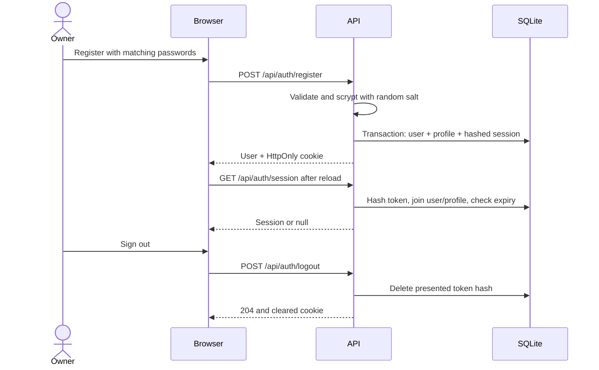
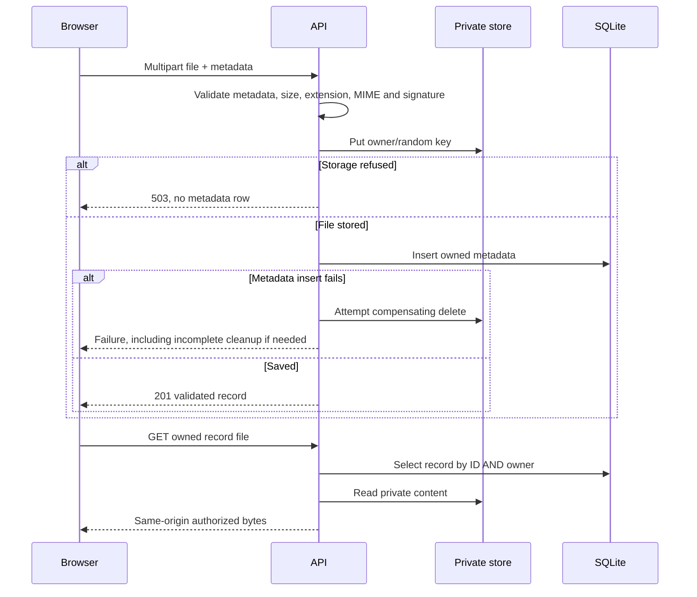
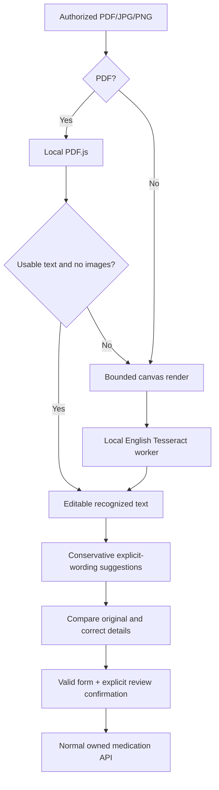

# Data Contracts and Request Flows

## Common contract

All private operations select by the authenticated owner. Mutation requests send
`X-MediVault-Request: 1`; supplied origins must match the request host or configured
`APP_ORIGIN`. JSON is limited to 64 KiB. Bodies are validated with strict shared
schemas; UUID parameters are validated separately. Success responses are
runtime-validated by the browser. Errors have `{ "error": "Helpful message" }`.

| Status          | Meaning                                                                                                                    |
| --------------- | -------------------------------------------------------------------------------------------------------------------------- |
| 400             | Invalid fields/JSON/schedule/current password or rejected document.                                                        |
| 401             | No valid session; private-client requests trigger workspace invalidation.                                                  |
| 403             | Request-protection/origin failure.                                                                                         |
| 404             | Unknown/unavailable owned entry or absent file; no other owner's metadata.                                                 |
| 409             | Duplicate email, duplicate dose coordinate, or password-change race.                                                       |
| 413             | Body/file size limit.                                                                                                      |
| 422             | The optional OCR provider returned no readable text.                                                                       |
| 429             | Authentication attempt limit.                                                                                              |
| 500 / 502 / 503 | Explicit server/provider/storage failure, never a successful placeholder. Do not assume every provider error is transient. |

Responses and files under `/api` use `Cache-Control: no-store`. Downloaded copies
remain sensitive; this header cannot erase an external saved copy.

## Authentication



The cookie path is `/api`, SameSite is Lax, lifetime is seven days, and production
requires Secure. Only the SHA-256 token hash is stored; passwords use scrypt, not
SHA-256. Login replaces a presented session. Password change verifies the current
password, performs a compare-and-update transaction and revokes other sessions.
There is no email verification, password-reset email or third-party identity flow.
Optional medication reminders do not provide authentication or account recovery.

Auth and data providers use request generations to ignore superseded results.
Private-client 401 responses invalidate the authenticated workspace; background
refresh failures retain previous data with a stale notice, not fabricated data.

## Family-profile assignment

Registration creates a `self` profile. The account owner can add household
profiles, then create records, medications, care tracks, and visits for the
selected person. Mutations include `family_member_id`; the API checks account
ownership, and database constraints/triggers repeat the ownership invariant.
A care track groups visits only when the owner chooses; records can be attached
to one visit or remain unassigned. Track/visit and visit/document links must
belong to the same family profile. A medication can link only to a prescription
record for the same profile. Changing the header selector filters the current
client view; it does not create another identity or grant access to another
login. The selector resets to `self` after a full reload.

The JSON export intentionally contains the full account dataset. The optional
printable activity summary uses only the selected profile's records,
medications, and related dose outcomes; owner health-profile fields cannot
appear in a different member's summary.

## Documents



PDF/JPG/PNG must be nonempty and at most 10,485,760 bytes. Matching signatures do
not constitute malware scanning or full PDF validation. File keys are private,
owner-scoped identifiers, never public or presigned delivery URLs.

Delete checks the owner, removes the stored file, then removes metadata. If the
second step fails, the API explicitly reports the partial failure and asks for
completion, not re-upload or blind database deletion. A process crash can still
leave a missing file or orphaned object: separate stores are not atomic.
Deleting a source unlinks medications without deleting their saved wording/logs.

Document-operation failures log only an allowlisted operation, opaque record ID
when available, and random incident ID. Before response headers are sent,
`X-MediVault-Incident` provides that correlation without exposing provider errors,
SQL messages, filenames, object paths, credentials or patient metadata. Upload
storage failures retain 503; other unexpected document-operation failures retain
500, and an owned missing file returns 404. These statuses do not diagnose a
provider 403 as transient. A failed stream after headers were sent is terminated,
not replaced with a successful JSON body.

Preview fetches/rendering are lazy and local. Closing/account expiry invalidates
late results, disposes object URLs/PDF work, and restores usable focus/scroll.
PDF preview page access is not limited by OCR's ten-page scan limit.

## Local-first OCR and human review



Local OCR supports clear printed English, at most ten PDF pages and 25
megapixels per rendered image. Cancellation terminates processing;
unrecognized/blank/protected input reports an error. Strength is not dosage.
No dates, dose times or clinical interpretations are inferred. Drafts are not
saved to localStorage; only reviewed, explicitly saved fields/excerpts persist.

An optional remote path exists only when `OCR_SPACE_API_KEY` is configured.
The user must affirm consent for the current scan; the API verifies that the
record belongs to the account before forwarding its bytes. Requests are limited
to 1 MB. The provider's free tier supports up to three PDF pages, but the
application does not preflight page counts. Its free service is not covered by
a signed DPA and must not receive real or sensitive health documents. Provider
errors are surfaced without exposing keys or response internals. OCR.Space is
an OCR service, not an LLM or medical interpretation system; local OCR remains
available as the default/fallback.

## Dose outcomes and time

```mermaid
sequenceDiagram
  actor Owner
  participant UI as Today's schedule
  participant API
  participant DB as SQLite
  Owner->>UI: Explicit Taken or Skip
  UI->>API: POST medication/date/time/status
  API->>DB: Check owned prescription and current schedule
  API->>DB: Insert unique medication/date/time outcome
  alt Duplicate or invalid
    API-->>UI: Conflict/validation error
  else Persisted
    API-->>UI: 201 recorded outcome
    UI->>API: Refresh owned dataset
  end
  Owner->>UI: Undo
  UI->>API: DELETE owned outcome
  API->>DB: Remove log
  API-->>UI: 204; schedule returns to unlogged
```

Start/end dates are inclusive. Schedule coordinates are local calendar dates and
wall-clock HH:MM, not UTC instants. Outcome coordinates cannot change after insert.
Schedule edits preserve original logs; they do not prove which historical
prescription was active. Calendar unlogged entries use the current schedule and
are explicitly projections, not verified historical/missed doses. Recorded
adherence is taken divided by logged outcomes, excluding unlogged entries.

## Optional email reminders

The signed-in owner can opt in and save an IANA time zone. Delivery is enabled
only when the server has `RESEND_API_KEY`, `EMAIL_FROM`, and a
`REMINDER_CRON_SECRET` of at least 32 characters. A separately managed external
scheduler calls `POST /api/internal/reminders` with that secret as a bearer
token; the application does not run its own always-on worker.

Each scheduler run checks the current and previous four minute slots for
opted-in users. The email contains a generic count and a link/sign-in prompt,
not medication or family-member names. A unique per-medication/date/time
delivery row and Resend idempotency key suppress duplicates; failed attempts
can be retried on later scheduler runs. Provider or scheduler failures can
still delay or prevent delivery, particularly on sleeping/free hosts. A
successful email request is not proof the dose was taken, and the reminder is
not an emergency alert or treatment instruction.

## Endpoint reference

Full field validation lives in [schemas](../shared/schemas.ts); response shapes
live in [contracts](../shared/contracts.ts). PATCH metadata/medication/care
requests use their complete form payload, not arbitrary merge patches.
Document responses include a strict `is_favourite` boolean. Favourite PUTs are
desired-state, owner-scoped writes: repeated equal states are idempotent and do
not rewrite metadata or document bytes. Metadata PATCH does not accept or clear
this flag. Missing/non-boolean/extra favourite fields return 400; ordinary
authentication, request-protection and inaccessible-owner errors remain
401/403/404 respectively.

| Endpoint                            | Request / response                                                                                                                |
| ----------------------------------- | --------------------------------------------------------------------------------------------------------------------------------- |
| `GET /api/health`                   | Database probe -> `{status:"ok"}`; not backup or document readiness.                                                              |
| `GET /api/auth/session`             | -> user session or null.                                                                                                          |
| `POST /api/auth/register`           | full_name/email/password/confirm_password -> session, 201.                                                                        |
| `POST /api/auth/login`              | email/password -> session.                                                                                                        |
| `POST /api/auth/logout`             | -> 204.                                                                                                                           |
| `POST /api/auth/password`           | current_password/password/confirm_password -> 204.                                                                                |
| `GET /api/vault`                    | -> owned profile, family members, preferences, feature flags, health profile, records, medications, logs, care tracks and visits. |
| `GET /api/account/export`           | Full account export, including archived historical measurements.                                                                  |
| `PUT /api/health-profile`           | Validated profile form -> saved health profile.                                                                                   |
| `POST /api/family-members`          | full_name/relationship/date_of_birth -> owner-managed profile, 201.                                                               |
| `PATCH /api/family-members/:id`     | Update an owned family profile; the account owner's self name uses health profile.                                                |
| `DELETE /api/family-members/:id`    | Deletes an empty non-owner profile; self is rejected (400), dependent data blocks deletion (409), other owners are hidden (404).  |
| `PUT /api/notification-preferences` | email_reminders_enabled/timezone -> saved opt-in settings.                                                                        |
| `POST /api/care-tracks`             | family_member_id/title/kind -> care track, 201.                                                                                   |
| `PATCH /api/care-tracks/:id`        | Update owned care track.                                                                                                          |
| `DELETE /api/care-tracks/:id`       | Deletes track; its visits remain standalone.                                                                                      |
| `POST /api/care-visits`             | family_member_id/care_track_id/title/reason/setting/provider/visit_date/notes -> visit, 201.                                      |
| `PATCH /api/care-visits/:id`        | Update owned visit and optional track association.                                                                                |
| `DELETE /api/care-visits/:id`       | Deletes visit; its documents become unassigned.                                                                                   |
| `POST /api/records`                 | Multipart file/family_member_id/visit_id/title/document_kind/provider/record_date -> record, 201.                                 |
| `PATCH /api/records/:id`            | Record metadata including family_member_id, visit_id and document_kind -> saved record.                                           |
| `PUT /api/records/:id/favourite`    | Strict `{is_favourite:boolean}` -> saved owned record, 200; desired state, not toggle.                                            |
| `POST /api/records/:id/ocr`         | `{confirm_external_processing:true}` -> OCR.Space text, only if configured and owned.                                             |
| `GET /api/records/:id/file`         | Authorized bytes; `?download=1` sets attachment.                                                                                  |
| `DELETE /api/records/:id`           | Confirmed owned deletion -> 204.                                                                                                  |
| `POST /api/medications`             | Prescription form -> medication, 201.                                                                                             |
| `PATCH /api/medications/:id`        | Prescription form -> saved medication.                                                                                            |
| `DELETE /api/medications/:id`       | Deletes prescription and cascading logs -> 204.                                                                                   |
| `POST /api/dose-logs`               | medication_id/scheduled_date/scheduled_time/status -> log, 201.                                                                   |
| `PATCH /api/dose-logs/:id`          | taken/skipped status -> saved log; coordinates immutable.                                                                         |
| `DELETE /api/dose-logs/:id`         | Undo -> 204.                                                                                                                      |
| `POST /api/internal/reminders`      | Bearer scheduler secret -> `{sent,failed}`; public route, secret-protected, optional.                                             |

There is no public file-list API, account-sharing API, diagnosis API, or server
endpoint that prescribes a medication. Sample data and JSON export are explicit
workflows over these ordinary owned endpoints. The former health-metrics API
returns 404; older rows remain in SQLite and are included only in account export.
