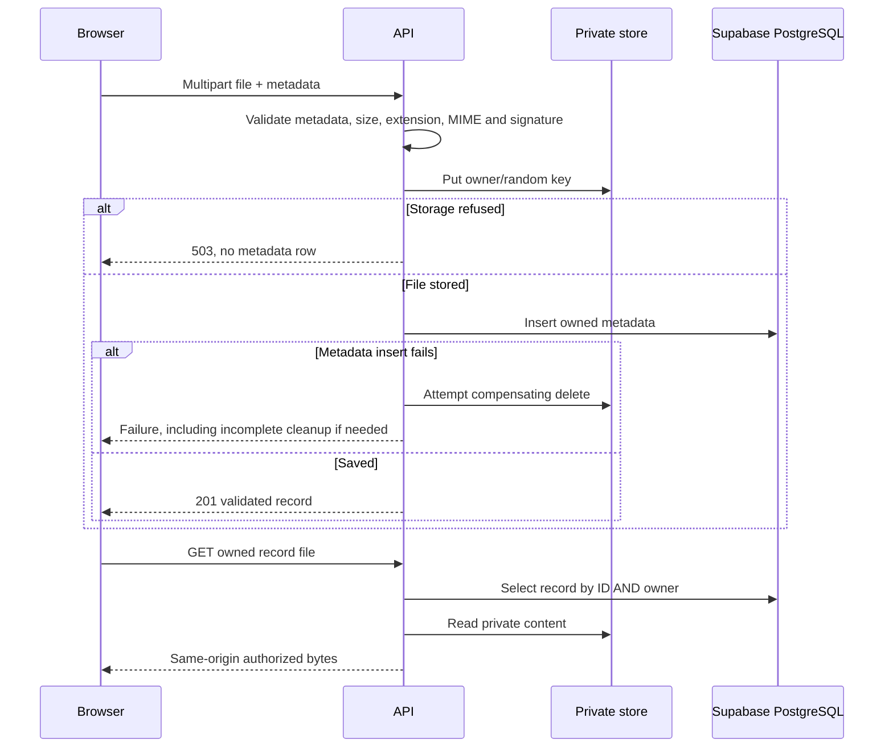
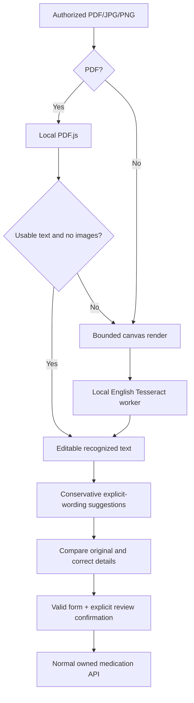

# Data Contracts and Request Flows

## Common contract

All private operations select by the authenticated owner. Mutation requests send
`X-MediVault-Request: 1`; supplied origins must match the request host or configured
`APP_ORIGIN`. JSON is limited to 64 KiB. Bodies are validated with strict shared
schemas; UUID parameters are validated separately. Success responses are
runtime-validated by the browser. Errors have `{ "error": "Helpful message" }`.

| Status          | Meaning                                                                                                                    |
| --------------- | -------------------------------------------------------------------------------------------------------------------------- |
| 400             | Invalid fields/JSON/schedule/current password or rejected document.                                                        |
| 401             | No valid session; private-client requests trigger workspace invalidation.                                                  |
| 403             | Request-protection/origin failure.                                                                                         |
| 404             | Unknown/unavailable owned entry or absent file; no other owner's metadata.                                                 |
| 409             | Account/data conflict, such as a duplicate email or dose coordinate.                                                       |
| 413             | Body/file size limit.                                                                                                      |
| 422             | The optional OCR provider returned no readable text.                                                                       |
| 429             | Authentication attempt limit.                                                                                              |
| 500 / 502 / 503 | Explicit server/provider/storage failure, never a successful placeholder. Do not assume every provider error is transient. |

Responses and files under `/api` use `Cache-Control: no-store`. Downloaded copies
remain sensitive; this header cannot erase an external saved copy.

## Authentication

```mermaid
sequenceDiagram
  actor Owner
  participant Browser
  participant API
  participant Auth as Supabase Auth
  participant DB as PostgreSQL
  Owner->>Browser: Register with matching passwords
  Browser->>API: POST /api/auth/register
  API->>Auth: Supabase signUp
  Auth->>DB: Bootstrap profile, self member and preferences
  Auth-->>API: User and session, or confirmation required
  API-->>Browser: User + HttpOnly Supabase cookies
  Browser->>API: GET /api/auth/callback?code=... (same browser)
  API->>Auth: exchangeCodeForSession using the PKCE verifier cookie
  API-->>Browser: 303 to fixed dashboard or safe login status
  Browser->>API: GET /api/auth/session after reload
  API->>Auth: getUser; refresh via request cookie adapter
  API->>DB: Read owner profile name
  API-->>Browser: Session, null, or retryable provider error
  Owner->>Browser: Sign out
  Browser->>API: POST /api/auth/logout
  API->>Auth: signOut(scope: local)
  API-->>Browser: 204 and cleared Supabase cookies
```

The request-scoped `@supabase/ssr` client reads and writes Supabase's chunked
session cookies. They are HttpOnly, SameSite=Lax, scoped to `/api`, and Secure in
production. `getUser()` verifies the provider session; it is not replaced with a
decoded JWT or the locally cached `getSession()` result. A provider outage returns
a retryable error and does not clear a valid cookie. Invalid or revoked sessions
are treated as signed out. The retired `medivault_session` cookie is cleared but
is never imported or used as a credential. Browser code receives only the
validated user profile, not access/refresh tokens, and does not store credentials
or healthcare data in browser storage.

Registration returns either an authenticated session or the typed
`confirmation_required` result. Confirmation callbacks exchange the one-time
PKCE code using the request's verifier cookie, then redirect only to the
configured application origin; callback query parameters cannot choose a
destination. Missing codes/verifiers, expired links and provider outages return
safe sign-in/retry guidance without echoing codes or claiming email delivery.
Configure the project Site URL and exact callback allowlist as described in the
development guide.
Passwords and session persistence belong to Supabase Auth; the application no
longer creates local password hashes or sessions. Password changes verify the
current password in an isolated non-persisted Auth client, revoke that temporary
session, update the active account and revoke other sessions. The active browser
keeps its session. Failure to revoke others after the update explicitly reports
that the password changed rather than suggesting the entire operation rolled back.
Website medication reminders do not provide authentication or account recovery.

Auth and data providers use request generations to ignore superseded results.
Private-client 401 responses invalidate the authenticated workspace; background
refresh failures retain previous data with a stale notice, not fabricated data.

## Family-profile assignment

Registration creates a `self` profile. The account owner can add household
profiles, then create records, medications, care tracks, and visits for the
selected person. Mutations include `family_member_id`; the API checks account
ownership, and database constraints/triggers repeat the ownership invariant.
A care track groups visits only when the owner chooses; records can be attached
to one visit or remain unassigned. Track/visit and visit/document links must
belong to the same family profile. A medication can link only to a prescription
record for the same profile. Changing the header selector filters the current
client view; it does not create another identity or grant access to another
login. The selector resets to `self` after a full reload.

The JSON export intentionally contains the full account dataset. The optional
printable activity summary uses only the selected profile's records,
medications, and related dose outcomes; owner health-profile fields cannot
appear in a different member's summary.

## Visit follow-ups

`PUT /api/care-visits/:id/follow-up` upserts one follow-up per actual visit.
The strict body is `{ due_date, instruction, source_record_id, status,
completed_visit_id }`; optional link inputs use an empty string. Ownership
and profile are resolved from the originating visit, never accepted from the
body. Responses contain the persisted row with nullable links. `GET /api/vault`
includes profile-filtered `followUps` in the client; account export includes the
full authorized `visit_follow_ups` collection.

The form accepts an exact date or positive whole calendar days after the visit,
not today. Calculated dates require explicit confirmation; changing the interval
or base date invalidates it. Past dates are supported for historical entry.
This is a follow-up due, not a booked appointment, and OCR cannot schedule it.
Pending dates remain pending after they pass. Users can reschedule, cancel,
complete, or reopen; only completed status permits an optional actual return
visit, and reopening/cancelling clears that link.

Source documents must belong to the origin. Return visits share its profile,
differ from it, and cannot precede it. Invalidating visit edits return 409 with
instructions to update the follow-up first. Source reassignment or deletion
clears the optional link; return deletion preserves the completion assertion.
Deleting the origin removes its follow-up while documents become unassigned.
Follow-up writes do not alter medication schedules, dose logs or visit dates.

The managed PostgreSQL schema enforces these rules independently of HTTP
validation. `save_visit_follow_up` upserts by originating visit, deriving owner
and profile from that visit; transaction locks serialize saves with origin and
return-visit edits. Composite foreign keys bind a source document to the origin
visit and clear only that optional link when the document is reassigned or
deleted. Return deletion clears its link without changing the completion status;
origin deletion removes only its own follow-up and unassigns its documents, and
track deletion leaves visits unassigned. Express uses these managed operations
with the current user's authorization.

Open a recorded visit in Medical records and choose **Add follow-up** or
**Edit follow-up**. The pending list is sorted by due date and remains visible
independently of document filters. **Open visit** clears document constraints
and reveals the origin. Completed/cancelled state stays within the visit.
Deletion confirmation explains that the origin's follow-up is removed.

## Records, medical history and health profile

- **Medical records** manages documents and actual visits. Visits start collapsed
  and interleave by visit date across care tracks. Multiple visits can remain
  expanded; changing profile resets expansion. Counts reflect documents and
  medications linked through that visit's sources, not an entire track.
  Track management and unassigned documents remain available.
- **Medical history** (`/medical-history`) reuses the saved care visualization
  for the selected profile, with no copied records or inferred relationships.
  It shows tracks, chronological visits, standalone/unassigned context, linked
  medications and read-only follow-up status. Document links open
  `/medical-records?record=<id>`; visits use `?visit=<id>`, including empty visits;
  medication links open `/medications?record=<source-id>`.
- **Health profile** retains demographic and personal health details. History
  sits above it in shared navigation and command search. The existing four
  mobile dock destinations remain; history is available in the mobile menu.

Records discovery aligns Search, Document type, Date order and Favourites in
one desktop row, with the result count below and responsive rows on narrow
screens. Filters combine before visits are rendered; hidden documents never
masquerade as genuinely empty visits. Active filters produce one no-match state
when nothing matches. Visit and record URL scopes combine, never widen one
another, and remain through metadata editing/preview dismissal. Clear filters
removes both scopes; unavailable links show an explicit no-match message.
Sort direction applies to visit dates for rows and record dates within visits,
not upload times. The care map no longer renders inside Medical records.
The vault fetch is still unpaginated; compact UI is not lifetime-scale retrieval.

## Documents



PDF/JPG/PNG must be nonempty and at most 10,485,760 bytes. Matching signatures do
not constitute malware scanning or full PDF validation. File keys are private,
owner-scoped identifiers, never public or presigned delivery URLs.

Delete checks the owner, removes the stored file, then removes metadata. If the
second step fails, the API explicitly reports the partial failure and asks for
completion, not re-upload or blind database deletion. A process crash can still
leave a missing file or orphaned object: separate stores are not atomic.
Deleting a source unlinks medications without deleting their saved wording/logs.

Document-operation failures log only an allowlisted operation, opaque record ID
when available, and random incident ID. Before response headers are sent,
`X-MediVault-Incident` provides that correlation without exposing provider errors,
SQL messages, filenames, object paths, credentials or patient metadata. Upload
storage failures retain 503; other unexpected document-operation failures retain
500, and an owned missing file returns 404. These statuses do not diagnose a
provider 403 as transient. A failed stream after headers were sent is terminated,
not replaced with a successful JSON body.

Preview fetches/rendering are lazy and local. Closing/account expiry invalidates
late results, disposes object URLs/PDF work, and restores usable focus/scroll.
PDF preview page access is not limited by OCR's ten-page scan limit.

## Local-first OCR and human review



Local OCR supports clear printed English, at most ten PDF pages and 25
megapixels per rendered image. Cancellation terminates processing;
unrecognized/blank/protected input reports an error. Strength is not dosage.
No dates, dose times or clinical interpretations are inferred. Drafts are not
saved to localStorage; only reviewed, explicitly saved fields/excerpts persist.

An optional remote path exists only when `OCR_SPACE_API_KEY` is configured.
The user must affirm consent for the current scan; the API verifies that the
record belongs to the account before forwarding its bytes. Requests are limited
to 1 MB. The provider's free tier supports up to three PDF pages, but the
application does not preflight page counts. Its free service is not covered by
a signed DPA and must not receive real or sensitive health documents. Provider
errors are surfaced without exposing keys or response internals. OCR.Space is
an OCR service, not an LLM or medical interpretation system; local OCR remains
available as the default/fallback.

## Dose outcomes and time

```mermaid
sequenceDiagram
  actor Owner
  participant UI as Today's schedule
  participant API
  participant DB as Supabase PostgreSQL
  Owner->>UI: Explicit Taken or Skip
  UI->>API: POST medication/date/time/status
  API->>DB: Check owned prescription and current schedule
  API->>DB: Insert unique medication/date/time outcome
  alt Duplicate or invalid
    API-->>UI: Conflict/validation error
  else Persisted
    API-->>UI: 201 recorded outcome
    UI->>API: Refresh owned dataset
  end
  Owner->>UI: Undo
  UI->>API: DELETE owned outcome
  API->>DB: Remove log
  API-->>UI: 204; schedule returns to unlogged
```

Start/end dates are inclusive. Schedule coordinates are local calendar dates and
wall-clock HH:MM, not UTC instants. Outcome coordinates cannot change after insert.
Schedule edits preserve original logs; they do not prove which historical
prescription was active. Calendar unlogged entries use the current schedule and
are explicitly projections, not verified historical/missed doses. Recorded
adherence is taken divided by logged outcomes, excluding unlogged entries.

## Website medication reminders

The open website compares the current local time with pending scheduled doses
and shows due/pending and next-dose status. Users record taken/skipped outcomes
themselves. Vault state refreshes every minute and on window focus. There is no
background/push guarantee and no medication email delivery.

The former notification-preference and scheduler routes are not mounted.
Historical database preference/delivery structures remain inert for compatibility.
Supabase Auth confirmation and recovery emails are independent and unchanged.

## Endpoint reference

Full field validation lives in [schemas](../shared/schemas.ts); response shapes
live in [contracts](../shared/contracts.ts). PATCH metadata/medication/care
requests use their complete form payload, not arbitrary merge patches.
Document responses include a strict `is_favourite` boolean. Favourite PUTs are
desired-state, owner-scoped writes: repeated equal states are idempotent and do
not rewrite metadata or document bytes. Metadata PATCH does not accept or clear
this flag. Missing/non-boolean/extra favourite fields return 400; ordinary
authentication, request-protection and inaccessible-owner errors remain
401/403/404 respectively.

| Endpoint                                     | Request / response                                                                                                                                      |
| -------------------------------------------- | ------------------------------------------------------------------------------------------------------------------------------------------------------- |
| `GET /api/health`                            | Database probe -> `{status:"ok"}`; not backup or document readiness.                                                                                    |
| `GET /api/auth/session`                      | Supabase `getUser()` and supported cookie refresh -> user session or null; outage is an explicit retryable error.                                       |
| `POST /api/auth/register`                    | full_name/email/password/confirm_password -> 201 with a session or typed confirmation-required result.                                                  |
| `POST /api/auth/login`                       | email/password -> session.                                                                                                                              |
| `POST /api/auth/logout`                      | Supabase local-session sign-out -> 204.                                                                                                                 |
| `POST /api/auth/password`                    | Verify current_password; set matching password/confirm_password and revoke other sessions -> 204, or explicit failure/partial-success error.            |
| `GET /api/vault`                             | -> owned profile, family members, preferences, feature flags, owner and family health profiles, records, medications, logs, care tracks and visits.     |
| `GET /api/account/export`                    | Full account export, including family health profiles and archived historical measurements.                                                             |
| `PUT /api/health-profile`                    | Validated account-owner profile form -> saved health profile.                                                                                           |
| `POST /api/family-members`                   | full_name/relationship/date_of_birth -> owner-managed profile, 201.                                                                                     |
| `PATCH /api/family-members/:id`              | Update an owned family profile; the account owner's self name uses health profile.                                                                      |
| `PUT /api/family-members/:id/health-profile` | Validated health details -> saved private health profile for an owned non-owner profile.                                                                |
| `DELETE /api/family-members/:id`             | Deletes an empty non-owner profile and its health details; self is rejected (400), dependent data blocks deletion (409), other owners are hidden (404). |
| `POST /api/records/:id/results`              | Reviewed measurement date and result rows -> append-only review; latest eligible profile fields sync atomically.                                        |
| `POST /api/care-tracks`                      | family_member_id/title/kind -> care track, 201.                                                                                                         |
| `PATCH /api/care-tracks/:id`                 | Update owned care track.                                                                                                                                |
| `DELETE /api/care-tracks/:id`                | Deletes track; its visits remain standalone.                                                                                                            |
| `POST /api/care-visits`                      | family_member_id/care_track_id/title/reason/setting/provider/visit_date/notes -> visit, 201.                                                            |
| `PATCH /api/care-visits/:id`                 | Update owned visit and optional track association.                                                                                                      |
| `PUT /api/care-visits/:id/follow-up`         | Idempotent manually managed follow-up; see visit follow-ups above.                                                                                      |
| `DELETE /api/care-visits/:id`                | Deletes visit; its documents become unassigned.                                                                                                         |
| `POST /api/records`                          | Multipart file/family_member_id/visit_id/title/document_kind/provider/record_date -> record, 201.                                                       |
| `PATCH /api/records/:id`                     | Record metadata including family_member_id, visit_id and document_kind -> saved record.                                                                 |
| `PUT /api/records/:id/favourite`             | Strict `{is_favourite:boolean}` -> saved owned record, 200; desired state, not toggle.                                                                  |
| `POST /api/records/:id/ocr`                  | `{confirm_external_processing:true}` -> OCR.Space text, only if configured and owned.                                                                   |
| `GET /api/records/:id/file`                  | Authorized bytes; `?download=1` sets attachment.                                                                                                        |
| `DELETE /api/records/:id`                    | Confirmed owned deletion -> 204.                                                                                                                        |
| `POST /api/medications`                      | Prescription form -> medication, 201.                                                                                                                   |
| `PATCH /api/medications/:id`                 | Prescription form -> saved medication.                                                                                                                  |
| `DELETE /api/medications/:id`                | Deletes prescription and cascading logs -> 204.                                                                                                         |
| `POST /api/dose-logs`                        | medication_id/scheduled_date/scheduled_time/status -> log, 201.                                                                                         |
| `PATCH /api/dose-logs/:id`                   | taken/skipped status -> saved log; coordinates immutable.                                                                                               |
| `DELETE /api/dose-logs/:id`                  | Undo -> 204.                                                                                                                                            |

There is no public file-list API, account-sharing API, diagnosis API, or server
endpoint that prescribes a medication. Sample data and JSON export are explicit
workflows over these ordinary owned endpoints. The former health-metrics API
returns 404. The archived export shape is retained, but this fresh managed
release does not import old measurements.
