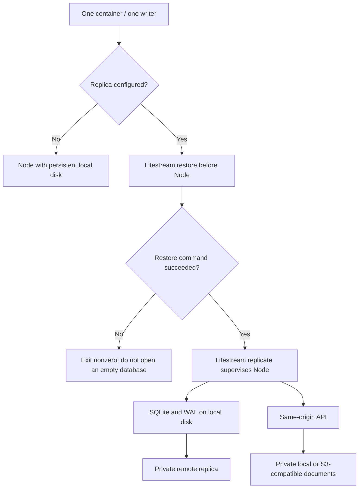

# Operations and Recovery

This is an operator runbook, not permission to change a live service, bucket,
retention policy or bill. Use fictional data for rehearsals. Never copy secrets,
document content, OCR, filenames or patient metadata into issues or diagnostics.

## What survives a restart

The [actual entrypoint](../docker/entrypoint.sh) restores with
`-if-db-not-exists -if-replica-exists`. A first authorized deployment with no
replica can start; inability to list/read an existing replica is not proof that
there is no replica. Any nonzero restore result refuses application startup.
An existing database does not justify removing that guard.

Run exactly one writer against a replica prefix. Never scale the service
horizontally or point a second running application at the same prefix.
[Configuration](../server/config.ts) validates production settings before the API
opens storage. The container runs as `node`; its data directory must be writable
only by the intended service account.

Render's free local disk is ephemeral and idle starts can be slow. With the
configured B2 store, document bytes and the SQLite replica are separate remote
objects. The [10-second sync interval](../litestream.yml) is a target, **not an
RPO guarantee**: network failure, provider caps, replication lag and abrupt
shutdown can lose a longer interval of database writes. Replication alone is not
an independent, verified point-in-time backup. Document and database versions
also do not form one atomic remote snapshot.

## Readiness is not durability

`GET /api/health` probes SQLite availability only. A 200 does not establish:

- document download or upload availability;
- successful replication, its last applied timestamp or its freshness;
- consistent database/document backups;
- the ability to restore a remote copy.

Do not add a remote bucket read to every health poll. After an authorized
deployment, incident, or planned low-frequency rehearsal, separately inspect
replicator status/provider usage and exercise a known **fictional** document
through its authenticated owner. Review actual replication progress and restore
evidence; do not infer them from successful uploads or a green API probe.

## Restore incident triage

1. Stop retrying redeploys as a diagnostic loop. Preserve sanitized startup
   messages, timestamps, deployment revision and provider request identifiers.
   Keep credentials and object paths out of shared logs.
2. Classify the reported failure before changing anything:

   | Reported evidence                   | Investigate                                                                                                                                    | Do not assume                                                                 |
   | ----------------------------------- | ---------------------------------------------------------------------------------------------------------------------------------------------- | ----------------------------------------------------------------------------- |
   | `Transaction cap exceeded`          | Authorized provider **Caps & Alerts**, transaction usage and reset timing. An operator may choose to restore allowance.                        | Every 403 is an invalid key, or a cap should be increased automatically.      |
   | Access denied without a cap message | Bucket restriction, replica-prefix permissions, endpoint/region and whether the configured key was revoked. Inspect secret settings privately. | All denied requests are transient or permission should be broadened globally. |
   | Timeout, DNS or TLS failure         | Provider status, endpoint spelling, certificate/clock and network reachability.                                                                | A replica is absent or local data should be deleted.                          |
   | Replica/format/version failure      | Deployed Litestream version, compatible replica format and the preserved replica's integrity.                                                  | Starting empty or changing database `user_version` repairs it.                |

3. Have the authorized owner restore the specific missing access/cap/network
   prerequisite. Never unset `LITESTREAM_REPLICA_PATH`, bypass restore, delete the
   replica, replace the database, or raise billing automatically to make startup
   green. Do not expose a key to prove that it is configured.
4. Redeploy once the prerequisite is restored. Confirm restore succeeds before
   application readiness; inspect replication progress separately.
5. In a previously established fictional account, verify medication/outcome IDs,
   record metadata and byte-identical download across restart. Record the actual
   recovered point and any gap; a new account is not proof of persistence.

Earlier isolated entrypoint verification covered ten success/failure sequencing
cases with fake commands and no credentials. That harness is now local-only,
not part of the published release gate. Its historical outcomes establish
**nothing about remote availability or real replica completeness**.

## Coordinated backup and isolated restore rehearsal

A real-provider rehearsal needs separate authorization and an isolated fictional
dataset. Agree on the target recovery point and acceptable gap before starting.

1. Inventory the deployed application revision, SQLite schema version,
   Litestream version, document store, replica prefix and retention settings.
   Record identifiers privately; do not export keys or personal data.
2. Quiesce the single writer and document mutations. Take a consistent SQLite
   backup using SQLite's backup facilities, or cleanly close/checkpoint the
   database before an offline copy. Copying an actively written main file alone
   can omit WAL contents; do not treat it as a valid backup.
3. Preserve the matching private document set and a controlled metadata/key
   inventory at that same quiescent point. Independently secure the backup and
   its access controls. Verify checksums of the fictional fixtures.
4. Restore to a new isolated target with separately scoped configuration and no
   connection to a running writer. Never start a second writer using the live
   replica prefix. Do not overwrite or experiment on the only backup.
5. With a compatible application version, check SQLite integrity/foreign keys,
   schema version, owner isolation, known profile/medication/outcome coordinates,
   and expected document bytes. Verify representative absent files too.
6. Record timing, recovered point, document/database consistency and observed
   gaps. Only the operator decides whether this proves the agreed recovery
   objective or a new backup is needed. Stop the owned rehearsal environment and
   remove only its explicitly identified fictional copies.

Do not change remote lifecycle/retention rules casually: retained document
versions and replica segments have different recovery roles. Review the
provider/Litestream retention policy against a tested restore, cost and approved
retention needs before changing it.

## Partial document operations

SQLite and the document store cannot commit together. See the
[request sequence](flows.md#documents) and [decision D3](decisions.md#d3-private-file-delivery-and-explicit-compensation).

| Failure boundary                               | Truthful state / next step                                                                                                                                                                                      |
| ---------------------------------------------- | --------------------------------------------------------------------------------------------------------------------------------------------------------------------------------------------------------------- |
| Upload put rejected                            | No successful metadata response. A remote write with a lost acknowledgment can still leave an object; do not claim the provider stored nothing.                                                                 |
| Metadata insert failed, compensation succeeded | Upload failed; the newly stored object was removed. Retry the ordinary upload after resolving the underlying failure.                                                                                           |
| Metadata insert and cleanup failed             | Upload failed; an unreferenced private object may remain. Preserve evidence and reconcile privately, not by inserting guessed metadata.                                                                         |
| File read failed                               | Keep metadata and report failure. A known missing object is 404; an unavailable provider is not silently replaced with blank bytes.                                                                             |
| Object deletion failed                         | Metadata remains. Resolve availability/permissions, then explicitly retry.                                                                                                                                      |
| Object deleted, metadata deletion failed       | Metadata may still be visible but its file is missing. The response explains the partial state; after resolving the database failure, explicit retry completes idempotent object deletion and metadata removal. |
| Stream failed after headers                    | The connection terminates; it cannot be converted into a new successful JSON/file response.                                                                                                                     |

Errors log an allowlisted operation, opaque record ID when known and random
incident ID; pre-header responses include `X-MediVault-Incident`. They do not log
raw provider/SQLite errors, object paths, original filenames or patient details.
Use the incident/time and authorized private inventory for triage, not a public
object listing.

For reconciliation, first take a coordinated backup and work from a private,
quiescent database/document inventory. Confirm ownership and references,
including medication source links, across **all** accounts before proposing a
repair. Distinguish an in-progress upload, orphan object and missing referenced
file. Restore known bytes from a verified matching backup when authorized;
otherwise explain the missing content to its owner. Never guess medical content.
Deleting an orphan, removing metadata, unlinking a source or performing live test
writes requires an explicit reviewed operator decision. No automatic sweep or
destructive repair tool is supplied by this change.

## Migrations and rollback

Schema version 3 adds default-false favourites without replacing documents or
IDs. Startup applies forward migrations transactionally and rejects unknown newer
versions. Before a live migration, preserve a coordinated backup and verify a
compatible restore.

Prefer a forward fix. Application rollback is safe only to code that understands
the current schema and contract; an older successful deploy can still reject
`user_version=3`. Never decrement `user_version`, drop columns or delete storage
to force old code to start. Restoring an older coordinated backup is a separate
authorized recovery operation with explicit loss of later writes, not routine
code rollback.

## Local Docker Desktop Recovery

Docker Desktop is a shared host service, separate from Render's engine and
MediVault's restore entrypoint. A local engine crash is not a reason to bypass
database restoration or change cloud credentials.

On 2026-11-17, read-only local diagnosis observed Desktop stopped, daemon startup
unavailable, both WSL2 distributions stopped, and `SIGBUS` / bus-error signatures
in the latest backend log. Earlier image unpacking reported `ENOSPC`.
Approximately 3.6 GiB remained free after removing only this task's temporary
acceptance export. A VM disk exists at the default WSL Docker location, but its
presence does not establish that it is the configured disk or that it is corrupt.
**The SIGBUS root cause is not established.** No diagnostic bundle was uploaded.

After separate operator approvals, a Desktop-only start reported already running
without daemon readiness; one Desktop-only restart then restored daemon 29.9.2.
The deployment image subsequently built and passed isolated local runtime
acceptance: database health, SPA deep link, non-root UID 1000, schema version 3,
required scanning assets and excluded local-only inputs. These are actual local
results, **not** pinned Linux visual acceptance, a hosted CI run or a B2 restore.
The owned container, fictional storage and two acceptance image tags were removed;
original images and shared build cache were retained. About **1.48 GiB remained
free** afterward: review capacity before another large build. Recovery is not a
guarantee that the fault cannot recur, and no global cleanup was authorized.

The operator subsequently cleaned C: independently; the final probe reported
about 58.46 GiB free and a responsive daemon. Capacity and service state are
time-specific observations, not settings or a guarantee for future builds.

1. Read Docker/WSL status, versions, capacity and narrowly relevant local log
   errors. Keep excerpts sanitized. Do not select automatic diagnostic upload.
2. Before another build, allow for image downloads, unpacked layers and build
   intermediates; a particular free-space number does not guarantee success.
   The production-only release does not need the large browser-verification image.
3. If Desktop is stopped, propose a Desktop-only start to the operator. Starting
   a shared engine may resume existing workloads. Obtain action-specific approval;
   do not stop Ubuntu, issue `wsl --shutdown`, reset Docker or globally prune.
4. If approved, perform that bounded action and check daemon readiness. If it
   fails, preserve the error and stop for another decision. A Desktop-only
   restart requires its own approval; do not escalate automatically to disk
   repair, uninstall/reinstall or deletion.
5. Before any storage repair/reset, confirm the actual configured VM disk,
   affected workloads and a separate backup destination with sufficient space.
   Docker must be fully stopped for its documented offline VM backup. Do not
   copy a large disk onto a nearly full system drive or delete the only copy.
6. Once the daemon and capacity are ready, build the deployment image and run an
   owned isolated container on an available port without cloud credentials.
   Record health, SPA deep-link serving, non-root execution and required runtime
   assets. Check that the build context/image excludes local suites, preservation
   files, secrets and personal data. Remove only the named owned container and
   its temporary data afterward.

Do not treat image compilation as runtime acceptance, or local runtime health as
Render deployment/B2 durability evidence. A failed or unexecuted check remains
explicitly incomplete.

Official guidance:
[troubleshooting](https://docs.docker.com/desktop/troubleshoot-and-support/troubleshoot/)
and [backup/recovery](https://docs.docker.com/desktop/settings-and-maintenance/backup-and-restore/).

## Evidence boundary

Published gates check source/build, production dependencies and image compilation.
They do not run functional suites or prove container startup, a B2 restore or
healthcare certification. Historical local fault-injection results, current
container acceptance and real-provider/manual work must be recorded separately.
Do not claim a deployment occurred without observing it.
