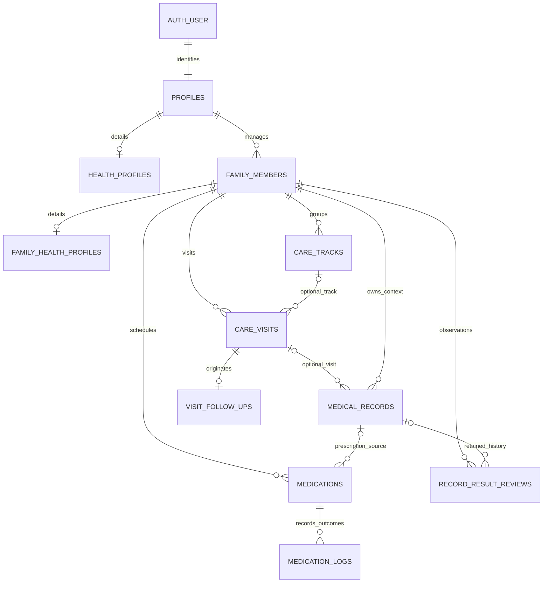

# Data Model Reference

## Sources of truth

The schema is managed by ordered, immutable
[Supabase migrations](../../supabase/migrations).
[Application types](../../shared/database.types.ts) and
[runtime response contracts](../../shared/contracts.ts) describe the application
boundary; they do not replace database constraints.

PostgreSQL stores identities, metadata, relationships and reviewed values.
Private Supabase Storage stores uploaded file bytes. A record's `file_path` is a
server-generated object key, not an authorized public download URL.

## Active application tables

| Table                    | Important fields / key                                                                                             | Responsibility                                        |
| ------------------------ | ------------------------------------------------------------------------------------------------------------------ | ----------------------------------------------------- |
| `profiles`               | `id` references Auth user, `full_name`                                                                             | Account-level identity                                |
| `health_profiles`        | UUID `id`, unique `user_id`, demographics, measurements, `medical_background` JSONB                                | Owner's health details                                |
| `family_members`         | UUID `id`, `user_id`, name, relationship, DOB                                                                      | One self member and owner-managed household profiles  |
| `family_health_profiles` | `family_member_id` primary key, `user_id`, health fields                                                           | Separate non-self health details                      |
| `care_tracks`            | UUID `id`, `user_id`, `family_member_id`, title, kind                                                              | Optional grouping of related visits                   |
| `care_visits`            | UUID `id`, owner/member IDs, optional track, date, setting, `provider`, notes                                      | Actual visit metadata, not appointments               |
| `visit_follow_ups`       | UUID `id`, unique `visit_id`, due date, status, optional source/return visit                                       | One manually recorded follow-up per originating visit |
| `medical_records`        | UUID `id`, owner/member/optional visit IDs, title, kind, `provider`, date, private object metadata, `is_favourite` | Searchable document metadata                          |
| `medications`            | UUID `id`, owner/member IDs, name, dosage, form, strength, frequency, times array, dates, source, wording          | User-entered existing prescription and schedule       |
| `medication_logs`        | UUID `id`, owner/medication IDs, original scheduled date/time, status, logged time                                 | Explicit taken/skipped outcomes                       |
| `record_result_reviews`  | UUID `id`, owner/member, nullable source and retained source key/title, measurement date, results JSONB            | Append-only reviewed-result snapshots                 |

Ordinary row types include creation/update timestamps; review snapshots are
append-only and use their creation timestamp. Clinical-looking profile values
are user-entered or explicitly reviewed, never inferred diagnoses.

## Ownership and integrity invariants

- `user_id` is the account owner. `family_member_id` selects someone managed by
  that owner; it is not another signed-in user.
- RLS predicates restrict ordinary access to `auth.uid()`. Composite foreign
  keys and triggers enforce same-owner/same-profile relationships independently
  of HTTP checks.
- Dose outcomes are unique by owner, medication, scheduled date and time.
  Changing the displayed schedule does not rewrite saved outcome coordinates.
- A medication source must be a prescription for the same profile.
- `provider` is one combined Hospital / Doctor string, at most 323 characters.
  Separate hospital/doctor columns were retired by a forward migration.
- Important marks persist as `is_favourite`; no separate bookmark table.
- Structured medical background has at most 20 typed allergy/condition rows.
  Compatibility summary text is retained for existing exports.
- Family deletion is guarded when associated data exists; the app does not
  cascade-delete a populated person's medical history.
- Track deletion preserves visits; visit deletion unassigns its documents.
  Source deletion clears optional links while preserving reviewed-result history.
  Explicit medication deletion removes its outcomes.

## Transactional operations

`get_account_vault_data`, `get_account_export_data` and
`get_reviewed_results` serve authorized snapshots.
`save_visit_follow_up` enforces origin/source/return-visit rules.
`save_reviewed_results` atomically appends a result snapshot and synchronizes
eligible latest profile values. Confirmed source measurement dates are fixed;
changing record metadata does not correct them.

`check_app_readiness` checks schema metadata with invoker permissions. Do not
solve startup failures by giving the service role direct patient-table SELECT.
The privileged server client is used for narrowly validated Storage operations;
ordinary patient queries use the request-bound user's authorization.

## Retained, inactive structures

`health_metrics`, `notification_preferences` and `reminder_deliveries` remain for
compatibility/legacy operations. The active UI has no standalone health tracker,
medication-email settings or mounted reminder worker route. Export contracts
retain archived-measurement shapes. Existence of a table, SQL function or source
module does not mean a product workflow is active.

## Storage and recovery boundary

Database transactions cannot include object Storage. Upload creates bytes then
metadata, with explicit cleanup if metadata fails. Delete removes bytes before
metadata and reports retryable partial failures. Database backups alone do not
prove document recovery; see the [operations runbook](../operations.md).
