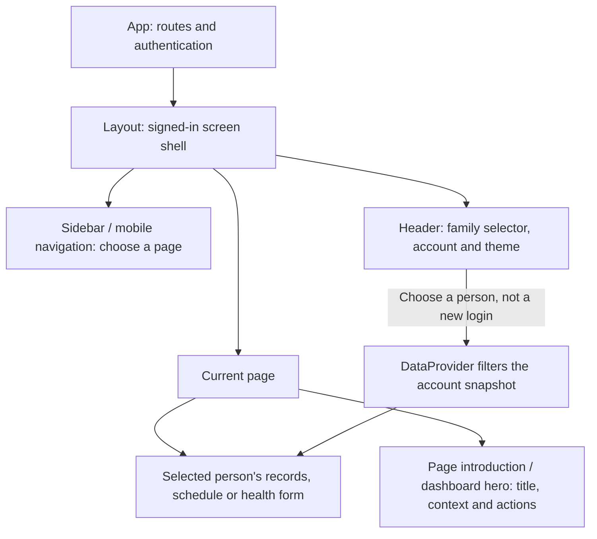
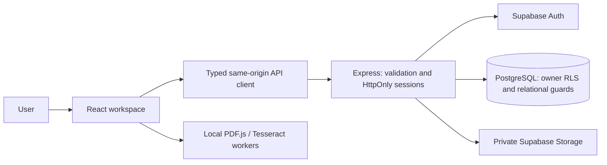
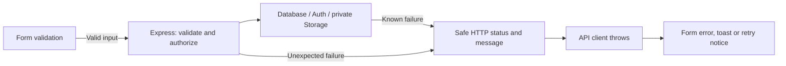

# MediVault System Overview

## Workspace screen tour

- **Sidebar:** the shared list of page links. React Router changes the current
  page without downloading a new HTML document for every click. Narrow screens
  use the mobile menu and bottom navigation instead.
- **Header:** the top workspace controls. Choosing a family member changes whose
  data is displayed, not which account is authenticated.
- **Hero/page introduction:** the greeting or page title and its nearby actions.
  The dashboard includes today's context and medication shortcuts; this is
  different from the shared header.
- **Search:** Medical Records has its own search for already loaded record
  metadata. The former header command palette and Ctrl+K shortcut are removed;
  use the sidebar and page action buttons instead. No PDF-content search is added.
- **Important!** filters documents marked using the star button. Existing saved
  marks are preserved; the internal `is_favourite` field keeps its original name.
- **Health Profile:** edits the selected person's details and structured
  allergy/condition rows. The family-management panel separately edits a managed
  person's name, relationship and birth date. Managed people have no separate
  login.

Implementation: [layout](../src/components/Layout.tsx),
[dashboard](../src/features/dashboard/pages/DashboardPage.tsx) and
[health profile](../src/features/profile/pages/ProfilePage.tsx).

### The few React concepts needed here

A **component** is a function that describes part of the screen using JSX
(HTML-like syntax inside JavaScript/TypeScript). A **prop** is input passed to
a component. **State** is a value React remembers between renders; updating it
asks React to redraw the relevant UI.

A **hook** lets a component use React behavior or shared application logic.
For example, `useState` remembers whether a dialog is open, `useAuth` reads the
shared login state, and `useVault` reads workspace data. These hooks do not
authenticate someone by themselves: the provider calls Express, and Express
validates identity with Supabase.

**TypeScript types** catch mismatched values during development. **Zod schemas**
also check actual incoming values at runtime, because browser requests and
network responses cannot be trusted merely because the source is typed.

## Request path

The browser sends same-origin HttpOnly cookies, not JavaScript-accessible tokens.
Express validates the user with Supabase Auth and uses a separate request-scoped
client for that user's ordinary data requests. PostgreSQL RLS independently
enforces account ownership. The server-only secret client is reserved for
controlled storage, readiness and Auth administration. Medication reminders use
the open website; the former medication-email routes are no longer mounted.

## Page and mutation lifecycle

1. [AuthProvider](../src/contexts/AuthProvider.tsx) obtains a real session through
   `/api/auth/session`. Protected routes wait for this result.
2. [DataProvider](../src/contexts/DataProvider.tsx) loads the account's
   `/api/vault` snapshot. The family selector filters the current profile view.
3. Forms use shared Zod schemas; [the API client](../src/lib/api.ts) adds the
   request-protection header and validates responses.
4. [Express](../server/app.ts) applies origin, request, session and cache rules.
   [Domain routes](../server/routes) validate input and use the user's RLS client.
5. PostgreSQL constraints/triggers and narrow RPCs preserve multi-row consistency.
   The shared mutation hook refreshes the owned vault after successful or failed
   writes. A refresh error is separate from whether the write itself succeeded.
6. Outages return explicit retryable failures, not an empty or local fallback.
   Request generations prevent stale responses from replacing newer state.

Fresh signup atomically creates the owner profile, one self family member and
default-off notification preferences. Confirmation-required signup displays a
pending state; the same-browser PKCE callback redirects only to the configured
application origin. Old accounts and data are not imported.
Unconfirmed users can request another signup link from the contextual resend
form. A resend response is not proof of delivery. Changing a known password is
supported; self-service forgotten-password reset is not implemented.

## What happens when something fails?

Different failures have different homes:

| Failure                              | What the user sees / what the code does                                              |
| ------------------------------------ | ------------------------------------------------------------------------------------ |
| Invalid form values                  | Field feedback before submission; Express repeats validation.                        |
| Authentication unavailable           | Retry guidance, not a fabricated signed-out success.                                 |
| Failed background vault refresh      | Last successful data stays visible with an explicit stale-data notice.               |
| Failed save/delete                   | Mutation error and notification; callers retain the form/confirmation for retry.     |
| Expired session on a private request | The auth provider invalidates the workspace.                                         |
| Rendering exception                  | The app error boundary shows a reload action; it does not catch all async failures.  |
| Partial document operation           | Explicit cleanup/retry error; safe document incident metadata is logged server-side. |

Cancellation and ignored superseded responses are deliberate lifecycle
decisions, not successful writes. See
[error-handling conventions](development.md#error-handling-conventions) and
[document failure branches](flows.md#documents).

## Data responsibilities

- [Managed migrations](../supabase/migrations) define PostgreSQL tables, RLS,
  relational guards, complete vault/export aggregates and worker functions.
- [Shared contracts](../shared/contracts.ts) preserve API numbers, booleans,
  nulls, calendar dates and minute-precision medication schedule times.
- Owner name synchronization is transactional. Family deletion refuses linked
  health data. Family members have no independent login or shared-access grant.
- Owner health details live in `health_profiles`; other managed members use
  `family_health_profiles`. Typed birth dates become calendar-date strings.
  Structured background rows preserve untouched legacy text and do not generate
  doctor instructions. See the [profile save flow](flows.md#health-profile-save).
- Reviewed results retain immutable review snapshots and source provenance.
  Saving eligible latest height, weight and blood group also updates the correct
  person's profile; unreviewed OCR text does not.
- Medication logs have unique, immutable schedule coordinates. Schedule edits
  retain earlier outcomes. The application never prescribes or infers dosing.
- Visits, documents, care tracks and manual follow-ups share owner/profile
  constraints. Track deletion unassigns visits; visit deletion unassigns documents.
- [The document adapter](../server/document-store.ts) stores private opaque
  owner-prefixed objects without overwriting existing bytes. Routes validate
  extension, MIME, magic bytes and the 10 MiB limit before uploading.
- Authorized file requests return same-origin bytes, not public bucket links.
  Object/metadata failures use explicit compensation and retry paths.
- Local OCR remains browser-side and review-only. Optional remote OCR requires
  per-scan consent and server configuration. Medication email delivery is
  disabled; current-time medication status is available while the website is open.

## Runtime and release

[Development startup](../scripts/dev-runtime.ts) checks port ownership, starts
Vite/API and verifies direct/proxied readiness. Production serves the immutable
build and API from one Express process. Startup validates Supabase settings,
HTTPS/cookies, frontend assets and managed-schema readiness before listening.
It never applies migrations or initializes a local database.

The [Dockerfile](../Dockerfile) builds without cloud credentials, runs as `node`
and listens on Render's port. [Render configuration](../render.yaml) preserves
health and checks-pass gates. Supabase owns persistence; no B2 credentials,
Litestream restore or writable host data disk is required.

`/api/health` proves managed-schema availability only. It does not prove Auth,
document availability, backup recoverability or a successful hosted release.
Supabase database backups do not contain object bytes.

See [deployment and recovery](operations.md) for private environment settings,
Auth redirect configuration, coordinated cutover and post-restart acceptance.
See [architecture](architecture.md), [request flows](flows.md) and
[development](development.md) for domain and verification details.
