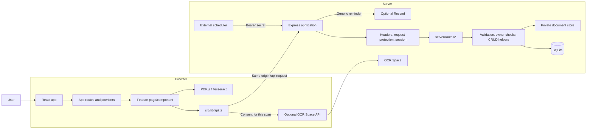
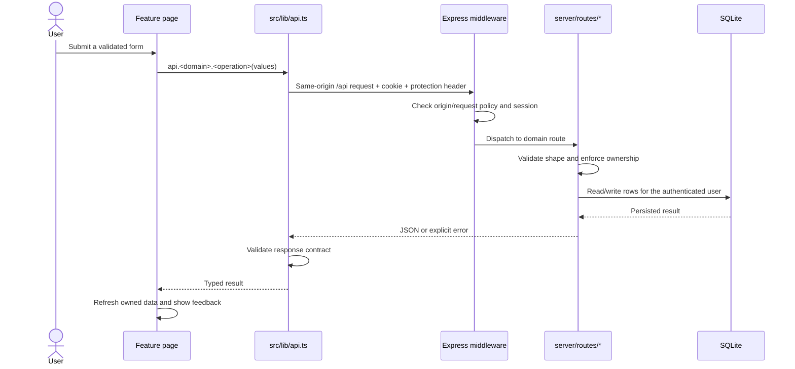
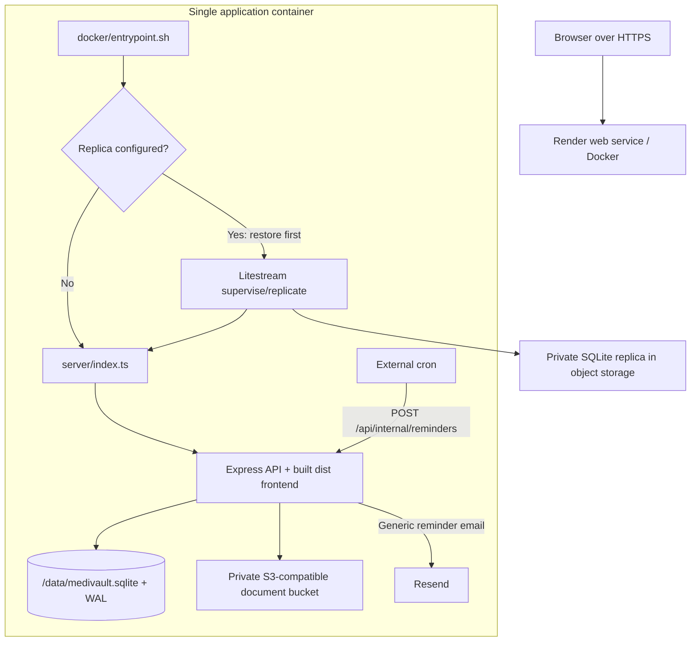

# MediVault System Overview

This guide follows one request from the browser to durable storage, then
explains how the same code is assembled and served in production. It is intended
to complement the [architecture map](architecture.md), detailed
[request flows](flows.md), [operations guide](operations.md), and
[development guide](development.md).

## 1. The system in one picture

The browser never connects directly to SQLite or the object store. The API is
the trust boundary: it validates data, identifies the signed-in user, and
checks ownership before reading or changing private rows and files.

## 2. A normal page load and API request

1. `src/main.tsx` mounts the React application and providers.
2. `src/App.tsx` waits for authentication state, selects a route, and guards
   private routes.
3. `src/contexts/AuthProvider.tsx` asks `src/lib/api.ts` for the current
   session. The browser sends the same-origin HttpOnly cookie automatically.
4. `src/contexts/DataProvider.tsx` loads the authenticated account's vault and
   provides it to feature pages.
5. A page under `src/features/` renders domain UI. Shared presentation lives in
   `src/components/`; feature-specific components stay beside their page.
6. A mutation calls a typed operation in `src/lib/api.ts`. That client adds the
   request-protection header, sends same-origin credentials, checks HTTP errors,
   and validates the response with a shared Zod contract.
7. Express middleware in `server/app.ts` applies security headers, API cache
   rules, request/origin protection, and the session boundary.
8. A route module in `server/routes/` validates the request and uses
   `server/routes/context.ts` for owner-scoped reads/writes. SQLite stores
   metadata; private document bytes are handled by the `DocumentStore`
   implementation.
9. The frontend refreshes the owned vault and reports success or an actionable
   error. It does not replace a failed API response with fake data.

The public health probe and public authentication endpoints are mounted before
the private API session middleware. Password changes, vault data, care
organization, documents, medications, and dose logs run behind authentication.
The retired health tracker has no active API; historical measurement rows
remain available through account export. See the [endpoint reference](flows.md#endpoint-reference) for exact paths.

## 3. Where responsibilities live

| Area                    | Main locations                                                         | What belongs there                                                                                   |
| ----------------------- | ---------------------------------------------------------------------- | ---------------------------------------------------------------------------------------------------- |
| Routes and providers    | `src/App.tsx`, `src/main.tsx`, `src/contexts/`                         | Route composition, session state, and loaded-vault state.                                            |
| Shared UI               | `src/components/`, `src/hooks/`, `src/lib/`                            | Layout, controls, request client, theme, reusable UI behavior.                                       |
| Feature UI and logic    | `src/features/<feature>/{pages,components,lib}/`                       | A workflow's pages, its domain components, and feature-specific derivations.                         |
| Client/server contracts | `shared/`                                                              | Runtime schemas, response contracts, shared row/domain types.                                        |
| HTTP composition        | `server/app.ts`                                                        | Middleware ordering, public/private boundary, route mounting, frontend serving, error mapping.       |
| API domains             | `server/routes/{auth,vault,care,records,medications,notifications}.ts` | Endpoint behavior grouped by resource/workflow, including optional integrations.                     |
| Route utilities         | `server/routes/context.ts`                                             | Per-app database/document dependencies, validation, sessions, owner checks, and common CRUD helpers. |
| Persistence             | `server/database.ts`, `server/migrations/`                             | SQLite startup, row decoding, transactions, and forward schema changes.                              |
| Document storage        | `server/document-store.ts`                                             | Private local/S3-compatible bytes behind one injectable interface.                                   |

Feature pages should call the API client rather than assembling fetch requests.
Routes should use shared schemas and owner checks rather than accepting a
user-supplied owner ID. Keep database and provider details out of React
components.

## 4. API and data boundaries

### Request validation

The client uses React Hook Form and Zod to help a person correct input before
submission. The server independently applies strict shared schemas; browser
validation is never treated as a security control. Response schemas catch an
incompatible or malformed API response before it becomes application state.

### Authentication and ownership

Passwords are stored as scrypt hashes. A successful login issues a random
HttpOnly, SameSite=Lax cookie; SQLite stores its hash rather than the raw token.
For each private request the server resolves the session and attaches the user
to the response locals. Route helpers always scope owned records by that user.
SQLite constraints and triggers add relational protections, but SQLite is not
PostgreSQL RLS.

Family members are owned rows under the account, not login identities. Every
record, medication, and retained measurement references one family profile.
The server verifies that the profile belongs to the current account, while
SQLite triggers defend the same invariant. Prescription-to-medication links
must also stay within one family profile. The selected profile is a client-side
view filter, not an authorization boundary and not a limit on the owner's
account-wide export.

### Database and document bytes

SQLite stores user/profile data, care tracks and visits, medical-record
metadata, medication details, dose outcomes, and retained historical health
metrics. Measurements are no longer part of the active product/API. Document
bytes are not public static assets: upload, read, and delete pass through
authenticated API handlers. The
database and document provider cannot commit atomically, so record upload/delete
paths have explicit compensation and partial-failure errors. See
[document flows](flows.md#documents).

### Prescription OCR and family profiles

The records feature provides PDF setup and OCR worker assets; the medication
feature provides prescription review and draft parsing. PDFs with usable
embedded text can use that text; image-based pages and image uploads use local
Tesseract OCR. The result is editable text plus heuristic candidate fields,
which a user must check against the original before saving. Nothing is saved
automatically. An optional OCR.Space integration can forward a record to an
external provider only when the server key is configured and the user confirms
consent for that scan. The free provider tier is not covered by a signed DPA and
must not receive real or sensitive health documents. Its 1 MB file limit is
checked by the API; PDF page limits are provider-side and are not preflighted.
Local OCR remains the default and fallback. There is no AI or clinical
interpretation.

An account owner can add household family profiles and assign records,
medications, care tracks, and visits to one profile at a time. A care track
groups related visits only when the owner chooses; unrelated visits stay
standalone, and records can remain unassigned. The header
selector filters the displayed workspace. These are owner-managed labels, not
separate accounts, delegated access, or a caregiver-sharing mechanism. The
health profile form remains the signed-in account owner's personal profile.
Older measurement rows are not deleted by the feature retirement and are
included in the full account JSON export.

## 5. Production runtime

The production Docker build compiles the browser application, checks emitted
assets, then copies the frontend build and required server/shared/OCR assets into
the runtime image. Express serves `dist/` and `/api` from the same origin. That
keeps cookies and private file requests same-origin; there is no separate public
frontend API credential. Optional provider credentials remain server-side.

When `LITESTREAM_REPLICA_PATH` is set, the container entrypoint attempts to
restore SQLite before starting Node. A failed restore exits instead of silently
starting with an empty database. Litestream then supervises the application and
replicates SQLite changes. Documents are stored separately through the
S3-compatible `DocumentStore`. The deployment is configured as one Render
instance; do not run multiple writers against the same SQLite replica prefix.

Email delivery is separate from application startup. To enable it, an operator
must set `RESEND_API_KEY`, `EMAIL_FROM`, and a 32-character-or-longer
`REMINDER_CRON_SECRET`, then configure an external scheduler to call
`POST /api/internal/reminders` regularly with that bearer secret. The endpoint
checks each opted-in user's time zone, sends a generic message without
medication or family-member names, and tracks delivery per scheduled dose to
avoid duplicates. Failed sends can be retried by a later scheduler call.
Delivery is best-effort: a sleeping/free host or unavailable scheduler/provider
can delay or miss a message. The email is not proof of a dose outcome or an
emergency/clinical alert.

The JSON export downloads the full authenticated account dataset, regardless
of the selected family profile. The printable activity summary is narrower:
it filters medications, dose outcomes, and record metadata to the currently
selected family profile. The owner's health-profile fields are never included
in a non-owner family member's summary; that member's name and date of birth
are included only when profile details are explicitly opted into the snapshot.

The live demo is configured by `render.yaml` and uses the free Render plan, a
private Backblaze B2 document bucket, and a Litestream replica. A successful
`/api/health` response proves only that the application and SQLite probe
responded. It does not prove document-store availability, replica freshness, or
restore capability. Render free instances can be idle and slow to wake. For
recovery and provider-specific triage, follow [operations and recovery](operations.md).

### Production error path

- Network failure: the frontend tells the user the Express API is unreachable;
  verify the service is awake and `/api` is routed to it.
- `401`: the private session expired; the client invalidates the signed-in
  workspace and asks the user to sign in again.
- `400`, `403`, `404`, `409`, `413`, `429`: show the server's helpful validated
  error (invalid input/request policy, inaccessible resource, duplicate,
  oversized upload, or auth rate limit).
- `5xx`: show a retryable failure. Document operations expose an opaque
  incident ID, not provider paths or credentials.

Do not treat retries as proof of data durability. Preserve safe diagnostic
details and consult the operations guide before changing storage, restoring, or
deleting anything.

## 6. Design system and interaction rules

MediVault's visual system is intentionally small: semantic colors and surface
tokens in `src/index.css`, utility composition through Tailwind, accessible
Base UI/shadcn-style primitives in `src/components/ui/`, and reusable page
patterns in `src/components/common.tsx`. Feature pages compose these rather
than introducing one-off button, dialog, or form behavior.

The shared layout provides responsive navigation. Light, dark, and system
appearance use the same semantic tokens; theme preference is stored in
browser-local storage, while authentication and health data are not. Forms use
field labels, validation messages, pending states, and success/error feedback.
Empty, loading, and error states should be explicit. Reduced-motion behavior and
keyboard/focus handling are part of the component contract, not decorative
afterthoughts.

The interaction model favors review over automation: no AI diagnosis, no
prescription changes, no automatic dose completion, and no implication that a
scheduled time proves a dose was missed. See [engineering decisions](decisions.md)
for the detailed trade-offs.

## 7. Why this stack, and why not more services?

- **React + TypeScript + Vite:** familiar component model and fast iteration;
  static frontend assets are simple to package with the API. A separate
  microfrontend architecture would add deployment and cross-origin complexity
  without an independently scaled product boundary.
- **Express + Node:** one deployable application can serve the API and frontend
  together. A separate API gateway/service topology is not justified for this
  single-instance MVP.
- **SQLite:** built into the chosen Node runtime and sufficient for a small,
  single-writer portfolio application. PostgreSQL/Supabase would be a better
  choice for multi-writer scaling, managed relational operations, or provider
  integrations, but would add a separate service and migration/operations work
  now.
- **Shared Zod contracts:** the same request/response definitions reduce drift
  between frontend and server while the server remains authoritative.
- **Local OCR workers:** keep report text in the browser and avoid an AI/OCR
  service key by default. Optional OCR.Space is a separate, consent-gated
  escape hatch with third-party disclosure risk and provider limits; it is not
  a medical interpretation service.
- **Resend plus external scheduler:** keeps keys server-side and supports
  opt-in generic reminders without a continuously running job worker. The
  trade-off is operational setup, best-effort delivery, and dependence on the
  host and scheduler being available.
- **Private local/S3-compatible document store:** separates file bytes from
  relational metadata and supports local development plus hosted object
  storage. It also introduces non-atomic failure boundaries that are handled
  explicitly.

These are current project trade-offs, not universal recommendations. Revisit
them when there is measured multi-writer load, reliable clinical-provider
integration, verified user demand for background reminders, or operational
requirements that SQLite and one container cannot meet.
