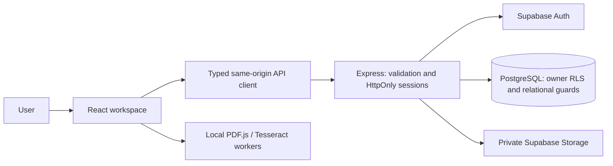

# MediVault System Overview

## Request path

The browser sends same-origin HttpOnly cookies, not JavaScript-accessible tokens.
Express validates the user with Supabase Auth and uses a separate request-scoped
client for that user's ordinary data requests. PostgreSQL RLS independently
enforces account ownership. The server-only secret client is reserved for
controlled storage, readiness, Auth administration and optional reminder work.

## Page and mutation lifecycle

1. [AuthProvider](../src/contexts/AuthProvider.tsx) obtains a real session through
   `/api/auth/session`. Protected routes wait for this result.
2. [DataProvider](../src/contexts/DataProvider.tsx) loads the account's
   `/api/vault` snapshot. The family selector filters the current profile view.
3. Forms use shared Zod schemas; [the API client](../src/lib/api.ts) adds the
   request-protection header and validates responses.
4. [Express](../server/app.ts) applies origin, request, session and cache rules.
   [Domain routes](../server/routes) validate input and use the user's RLS client.
5. PostgreSQL constraints/triggers and narrow RPCs preserve multi-row consistency.
   The browser reloads the owned vault after successful mutations.
6. Outages return explicit retryable failures, not an empty or local fallback.
   Request generations prevent stale responses from replacing newer state.

Fresh signup atomically creates the owner profile, one self family member and
default-off notification preferences. Confirmation-required signup displays a
pending state; the same-browser PKCE callback redirects only to the configured
application origin. Old accounts and data are not imported.

## Data responsibilities

- [Managed migrations](../supabase/migrations) define PostgreSQL tables, RLS,
  relational guards, complete vault/export aggregates and worker functions.
- [Shared contracts](../shared/contracts.ts) preserve API numbers, booleans,
  nulls, calendar dates and minute-precision medication schedule times.
- Owner name synchronization is transactional. Family deletion refuses linked
  health data. Family members have no independent login or shared-access grant.
- Medication logs have unique, immutable schedule coordinates. Schedule edits
  retain earlier outcomes. The application never prescribes or infers dosing.
- Visits, documents, care tracks and manual follow-ups share owner/profile
  constraints. Track deletion unassigns visits; visit deletion unassigns documents.
- [The document adapter](../server/document-store.ts) stores private opaque
  owner-prefixed objects without overwriting existing bytes. Routes validate
  extension, MIME, magic bytes and the 10 MiB limit before uploading.
- Authorized file requests return same-origin bytes, not public bucket links.
  Object/metadata failures use explicit compensation and retry paths.
- Local OCR remains browser-side and review-only. Optional remote OCR requires
  per-scan consent; optional email requires consent, credentials and a scheduler.
  Neither is necessary to run the core website.

## Runtime and release

[Development startup](../scripts/dev-runtime.ts) checks port ownership, starts
Vite/API and verifies direct/proxied readiness. Production serves the immutable
build and API from one Express process. Startup validates Supabase settings,
HTTPS/cookies, frontend assets and managed-schema readiness before listening.
It never applies migrations or initializes a local database.

The [Dockerfile](../Dockerfile) builds without cloud credentials, runs as `node`
and listens on Render's port. [Render configuration](../render.yaml) preserves
health and checks-pass gates. Supabase owns persistence; no B2 credentials,
Litestream restore or writable host data disk is required.

`/api/health` proves managed-schema availability only. It does not prove Auth,
document availability, backup recoverability or a successful hosted release.
Supabase database backups do not contain object bytes.

See [deployment and recovery](operations.md) for private environment settings,
Auth redirect configuration, coordinated cutover and post-restart acceptance.
See [architecture](architecture.md), [request flows](flows.md) and
[development](development.md) for domain and verification details.
