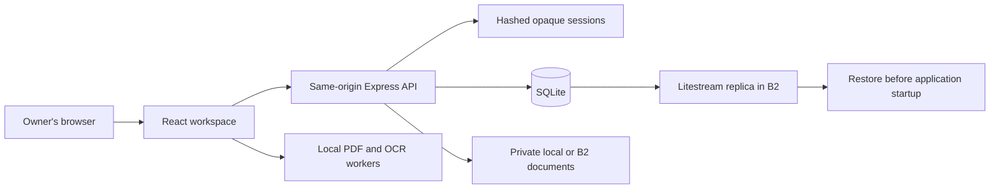

# Design

## Context

See [proposal.md](proposal.md) for motivation and approved scope, and [review.md](review.md) for the read-through ledger, findings F1-F8, references, and evidence limitations.

The actual product is React/TypeScript/Vite/Tailwind/shadcn with Express, Node SQLite, private local or S3-compatible documents, and local Tesseract/PDF.js workers. It is not the original Supabase/Recharts concept. The existing modular monolith, shared validation, account-scoped queries, lazy routes, and single-writer deployment are appropriate for this MVP.

The diagram describes trust/data boundaries, not independent deployable services. SQLite and document storage are not a distributed transaction. Health probes check the database, not remote backup freshness.

No application changes, new dependencies, runtime tests, live recovery, or deployment occur during this proposal. Historical verification is evidence of the preceding change only.

## Goals / Non-Goals

**Goals**

- Fix F1 with an honest, testable definition before adding engagement feedback.
- Use one small persistence extension, existing data, and existing product surfaces for the three approved features.
- Make motion coordinated rather than cumulative: one route arrival, one optional explicit theme gloss behind live content, bounded feedback, static ambient depth.
- Turn previous ad hoc browser acceptance into isolated, maintained checks.
- Explain the codebase through a module map, diagrams, decisions, and operational procedures that match actual behavior.

**Non-goals**

- No speculative SOLID rewrite, new repository/service layers without demonstrated need, or file splitting solely to reduce line count.
- No historical prescription versioning, prescription interpretation, missing-dose inference, extra-dose goals, or clinical adherence claims.
- No real cloud test writes, automated billing changes, deployment changes, broad data repair, pagination/streaming project, or graphics runtime.
- No blanket comments on every function. Explain public boundaries and non-obvious invariants; let names and focused code express straightforward operations.

## Decisions

### 1. Preserve the architecture; use evidence-led fixes

Keep the current API, providers, domain helpers, and SQLite/document-store modules. F1 is a concrete semantic fix. F2-F5/F7-F8 justify targeted motion, test, diagnostic, and documentation work. F6 remains a documented scaling trigger, not a reason to implement pagination or upload streaming now.

Where fault tests expose a directly coupled defect, fix it in the same bounded stage and link the regression. Do not silently expand the feature scope; materially different persistence or recovery requirements require revising this change.

Alternatives rejected: microservices, ORM migration, wholesale state management, replacing SQLite, and unsolicited architecture abstraction. They increase migration/operational risk without solving the observed defects.

### 2. Derive consistency from recorded dates, never reconstructed completeness

Extend the existing dashboard domain helpers with a single shared logged-day derivation reused by insights and milestones:

1. Select the owner's actual taken/skipped logs whose original `scheduled_date` is not after local today.
2. Count unique date strings, not dose count, log-creation time, or projected schedule entries.
3. Compute a current consecutive run ending today if present, otherwise yesterday; if neither qualifies, the current run is zero.
4. Compute lifetime distinct-date milestones at 3, 7, and 30. A skipped outcome contributes equally to a logged day.
5. Recompute from actual state after undo, medication deletion, refresh, and account change. Never persist an independent achievement table or browser-health cache.

Use calendar date arithmetic rather than subtracting 86,400,000 milliseconds. Show the run's ending date and use wording such as "days with recorded outcomes." Schedule changes can retain a recorded day but cannot establish full historical prescription completion.

The existing "taken divided by logged" adherence ring, Daybook priority, seven-day display, and calendar projection disclosures stay intact. This deliberately changes the main dashboard spec's old fully-logged streak example. Existing projected chart values are not reused as milestone facts.

Feedback is tied to confirmed explicit mutations, not a provider effect watching counts. Reload, passive refresh, and sign-in do not celebrate. Pending/error/undo cases retain readable, neutral outcomes; no shame, health promises, or incentive to take another dose.

Alternative rejected: snapshotting every prescription version to prove historical completeness. That is a larger clinical/history domain, unnecessary for an honest logging-day feature.

### 3. Add favourites to the owned record, not another storage system

Add a forward migration such as `003_record_favourites.sql`:

- `medical_records.is_favourite`: `INTEGER NOT NULL DEFAULT 0` with a 0/1 constraint.
- Keep existing IDs, owners, file keys, source links, dates, and previous migrations intact.
- Normalize SQLite's integer representation to a real boolean in the HTTP response and shared record contract. Do not loosen response validation or silently default malformed responses.

Add `PUT /api/records/:id/favourite` with a strictly validated `{ "is_favourite": true | false }` request and an updated-record response. Use the existing session, custom mutation header, origin protection, owner selection, and unavailable-record response conventions.

The endpoint sets desired state, not "toggle," so retries and repeated same-state requests are idempotent. Concurrent different desired states use last committed write; no versioning or compare-and-swap is needed for this low-risk preference. A metadata edit must not reset the flag, and favourite changes must not rewrite file content or unrelated metadata.

Use the existing typed client/mutation pattern. Do not optimistically claim persistence: show pending state, then confirmed state, and preserve the previous state on failure. Guard/account-scope refreshes as existing providers do.

Add a labelled, pressed-state control on vault cards and a favourites-only discovery control. Keep current date sorting; do not silently pin favourites above existing results. Combine all filters and source-record scope. Reset clears discovery constraints but never saved favourites. If unfavouriting removes the focused card from favourites-only results, return focus to a stable result/heading.

Existing exports include the additive favourite field; old metadata requests remain valid. No favourite-specific index is needed for a boolean filtered in the already-loaded dataset.

Alternatives rejected: localStorage favourites (not owner-persistent or appropriate for healthcare metadata), a separate favourite table (unnecessary many-to-many model), and a blind toggle endpoint (unsafe retries).

### 4. Generate a fresh in-memory activity snapshot and use browser print

Expose a lazy-loaded Activity summary view from Settings. Reuse existing dialog/page primitives, with a mobile full-screen, scrollable preview; do not add another primary navigation destination.

- Provide seven-day, thirty-day, and explicit inclusive date bounds, defaulting to the last thirty local dates including today. Reject invalid/reversed/future bounds.
- On Generate, use the existing authenticated `GET /api/vault` client to obtain a fresh snapshot. Freeze the selected range and fetch timestamp with that in-memory snapshot; do not substitute stale provider data after a failed request.
- Changing dates invalidates print readiness until regeneration. Generation has a request/version and current-account guard; close, sign-out, or session invalidation clears it and ignores late responses.
- Show stored outcome rows and taken/skipped totals filtered by original scheduled date, not log creation time. If showing recorded adherence, use taken/logged only and show unavailable for zero logs.
- Separately identify current saved medication details, not historical prescription versions. Include date-filtered record metadata using `record_date`; never attach or fetch document bytes for the summary.
- Optional profile details start excluded and require explicit selection. Do not print emergency contacts, allergies, OCR excerpts, or legacy measurements merely because the vault response contains them. Existing JSON export retains its broader current behavior.
- Include selected range, generation time, current-detail provenance, projection limitations, and a sensitive-copy warning. Missing sections are explicit empty states.

Use scoped `@media print` / `@page` styles: readable light paper, navigation/actions hidden, portal/fixed/scroll constraints reset, wrapping text, usable page breaks, and no animation. Print only the generated summary, not the underlying workspace. The Print / Save as PDF control calls `window.print()` after the preview is ready; returning from the browser dialog never means the user saved anything.

Automate print-media content/layout assertions and primary-engine PDF rendering; verify the print invocation once without trying to automate an operating-system save dialog. Document a brief manual cancel/save rehearsal.

Alternatives rejected: persisted report snapshots, server PDF generation, a new PDF library, or cloud sharing. All create unnecessary sensitive copies or dependencies for this use case.

### 5. Separate route motion, explicit appearance gloss, and decoration

Keep the existing router mode and lazy boundaries. Route changes use one coordinated CSS arrival (about 180-220 ms, subtle opacity/translation), without blocking navigation for an exit animation. Preserve working focus/scroll behavior, including the preview's focus/scroll restoration. Avoid nested per-card entrances multiplying a whole-page transition.

For explicit appearance selection, apply semantic theme colors immediately and atomically through the existing preference/store helper. Optionally run a roughly 420 ms CSS-only gloss on the decorative background, capped at 500 ms. Keep it behind content and non-interactive: text, controls, focus rings, and hit-testing stay live and unobscured. Do not capture page snapshots, crossfade foreground/background colors, or fade the whole document through a low-contrast intermediate state.

Reduced motion, unsupported CSS animation, system appearance updates, and cross-tab synchronization use an immediate static semantic change. Missing decoration or cancellation must not prevent the actual preference update, duplicate it, or swallow persistence errors. No native transition API, user-agent exclusion, new dependency, or asynchronous theme commit is required.

Cancel an active gloss before a replacement; the latest selection wins synchronously. Cancel decoration on route/account changes, sign-out/session invalidation, and runtime reduced motion. The decorative effect contains no outgoing private content and cannot revive it. Store only the existing appearance preference, never snapshots, document bytes, or health information.

Overlays/selection/confirmed check-ins use the shared duration/easing vocabulary and finish within 250 ms. Small icon/card perspective is CSS-only, fine-pointer-only, and never alters reading geometry, hit targets, or focus rings. Ambient color washes become static. The original authentication SVG keeps its pause/resume control and static reduced-motion alternative.

The owner-approved documentation reconciliation supersedes the older blanket 300 ms limit: workspace interactions remain capped at 250 ms, explicit appearance background gloss at 500 ms (currently about 420 ms), and the restored authentication entrance at 460 ms. The existing pausable authentication illustration is the sole continuous decorative exception and becomes static with reduced motion. No ongoing animation is introduced elsewhere.

Alternatives rejected: native full-page snapshots (real Chromium hit-testing blocks live controls, and the full Windows WebKit application crashes during presentation), full-page low-opacity crossfades (contrast), a router-mode rewrite to get navigation snapshots (scope), WebGL/Three.js/Framer Motion (cost and accessibility), and scroll parallax (distraction/vestibular risk). Minimal native probes do not justify declaring an entire browser API unsupported; background-only CSS avoids this integration problem without a browser denylist.

### 6. Keep unit/API checks fast; add an explicit full verification gate

Preserve `npm run verify` and existing cross-platform suites. Add a documented `test:e2e` command and a `verify:full` orchestration that executes existing verification once, then E2E against the resulting immutable build. The E2E runner does not rebuild while browser requests use hashed assets.

Use Playwright as a development-only dependency because existing component/Supertest tests cannot establish real focus, composited contrast, responsive geometry, worker delivery, or printed output. Install browser prerequisites explicitly; missing tooling fails with useful setup instructions rather than silently skipping.

The fixture starts an owned production server on loopback with isolated temporary storage and fictional credentials. Use a fixture-local HTTPS reverse proxy with an ephemeral self-signed certificate so real `Secure` cookies work consistently across browser engines without weakening production validation. A development-only certificate generator such as `selfsigned` is justified for this fixture; keep its private key in memory, use browser-context `ignoreHTTPSErrors` only for this owned origin, and close both proxy and backend at teardown. Preserve the browser's same-origin Host/Origin and configure the isolated backend's trusted `APP_ORIGIN` accordingly. Do not depend on engine-specific insecure-localhost cookie exceptions or point tests at a running app or Render.

Use a pinned Chromium/Linux environment for primary journeys and visual references. Add Firefox/WebKit smoke journeys for navigation, appearance, and private preview. Windows retains existing verification; the heavier browser matrix runs as a required Linux job. Screenshot baselines are platform/browser-specific, with fixed fixture dates and paused decorative animation. Do not bulk-approve newly generated snapshots without inspecting them.

| Layer                | Required evidence                                                                                                                                                                                                                                                           |
| -------------------- | --------------------------------------------------------------------------------------------------------------------------------------------------------------------------------------------------------------------------------------------------------------------------- |
| Domain/components    | Milestone distinct-day/run/undo/edit/DST semantics; favourite discovery/pending/failure/focus; summary date/provenance/late-response behavior; supported/unsupported/reduced-motion theme paths.                                                                            |
| API/database         | Existing CRUD/isolation retained; v2-to-v3 migration preserves populated data; favourite desired-state validation/idempotence/ownership/restart; duplicate dose conflicts.                                                                                                  |
| Document store       | Upload rollback/cleanup failure, download failure, store-delete failure, and database failure after object deletion; assert truthful state/errors and untouched other-account fixtures.                                                                                     |
| Production browser   | Registration/reload/login/logout/password/profile; real upload/edit/filter/private preview/download/delete; medication edit/delete/calendar/source links; Taken/Skipped/Undo; favourites, export, summary, appearance, and command navigation.                              |
| Real local workers   | One fixed printed image fixture uses actual OCR, a text PDF exercises local PDF parsing, cancellation stays cancelled, and review is required before valid save. Block external requests; mocks supplement but do not replace this journey.                                 |
| Failure browser      | Session expiry and late preview/summary responses; failed mutation with retained form input; failed background refresh/stale label; invalid upload; duplicate/pending interactions.                                                                                         |
| Visual/accessibility | Every current page at five required widths in both themes; representative overlays and summary at narrow/wide sizes; actual viewport assertions, no overflow/covered controls, keyboard focus/trapping/return, target dimensions, composited text contrast, reduced motion. |
| Deployment           | Existing image smoke plus entrypoint restore wiring with fake local commands; failure exits before Node/database creation, success reaches startup once, no replica bypass; real cloud restore remains a separately authorized operator rehearsal.                          |

Use behavior assertions over screenshots for persistence and safety. Use deterministic network fault injection only for failure paths, not to replace the happy-path API. Keep traces/screenshots/downloads fictional, retain failure artifacts for diagnosis, and clean owned processes/temp storage in finally/teardown paths. No arbitrary sleep-based success checks or permissive retry policy to hide flaky tests.

Alternatives rejected: replacing existing suites with an E2E mega-test, a new coverage-percentage gate unrelated to risk, and requiring cloud credentials in CI.

### 7. Make failure boundaries testable without rewriting storage

Use the existing document-store injection seam for operation failures and narrow database fault fixtures for compensation paths. Preserve existing explicit failure statuses unless a reliable operation/provider classification supports a change. Add sanitized operation labels and request/record correlation where needed; never log tokens, credentials, document bodies, OCR, or patient metadata.

Exercise the actual container entrypoint under a local stub `litestream`/application launcher to record sequencing. Assert restore denial/cap/unknown failure refuses launch and leaves fixture data intact; assert success and unconfigured replication select their correct startup path. This tests fail-closed wiring, not whether a real remote replica is complete.

Keep `/api/health` cheap and database-focused. The runbook explains provider usage/caps, document access, and replica/backup verification as separate, explicit low-frequency checks. Do not increase B2 operations with a remote probe per health poll, and do not bypass the restore guard in response to cost or access failure.

### 8. Build a linked handbook, not a giant README or invented process

Create a small `docs` index with focused documents and link it from the README. Exact file grouping can follow the existing content; these are the required information boundaries, not a demand for one file per paragraph:

| Document area                  | Required content and diagrams                                                                                                                                                                                                                                           | Why it belongs here                                                                                         |
| ------------------------------ | ----------------------------------------------------------------------------------------------------------------------------------------------------------------------------------------------------------------------------------------------------------------------- | ----------------------------------------------------------------------------------------------------------- |
| Architecture and module map    | Stack, actual folder/file responsibility map, trust boundaries, context/container/deployment flowcharts, core ERD including sessions and source links.                                                                                                                  | Explains what runs where and how shared helpers/providers/API/storage relate.                               |
| Data and request flows         | Auth/session sequence; upload/compensation/authorized preview/delete; local OCR/review/save; dose uniqueness/edit/undo; startup/restore/replicate. API method/request/response/error table and local-date/time conventions.                                             | Makes invariants and failure branches understandable without reading every call site.                       |
| Decisions                      | Concise ADR-style context, decision, alternatives, consequences for SQLite/single writer, opaque sessions, private proxy delivery, local OCR, projected history, derived milestones, favourite idempotence, browser print, and progressive motion.                      | Records why/how/where instead of retrofitting abstraction or claiming enterprise certification.             |
| Contributor workflow and setup | Windows and POSIX setup, optional configuration with no secrets, repo map, fictional demo, safe process ownership, formatting/types/tests, incremental OpenSpec-to-review-to-release flow and acceptance traceability.                                                  | New contributors can run and explain the app; the lightweight iterative/incremental SDLC fits the project.  |
| Verification strategy          | Test pyramid, real/mocked/manual matrix, commands and browser prerequisites, deterministic fixtures, baseline policy, known limits, evidence format, safe failure triage.                                                                                               | Distinguishes tested invariants from wishes or environment-dependent results.                               |
| Operations and recovery        | Render/B2 topology, secret ownership, caps versus authentication/network errors, cold starts, single writer, approximate recovery point, coordinated DB/document backup limits, staged restore rehearsal, forward migrations, rollback and partial-file reconciliation. | Captures the recent cap incident without destructive shortcuts or pretending a health probe proves backups. |

Include Mermaid diagrams with explanatory prose and linked source boundaries. Validate links and diagrams with available project/GitHub rendering tools; do not add a documentation framework solely for this change. Use non-obvious comments for invariants, not redundant prose on every line.

Extend the review ledger during implementation with disposition, regression-test link, command, outcome, and remaining limitation. Do not claim a formal Scrum organization, HIPAA/SOC certification, production load envelope, or exhaustive coverage absent evidence.

## Risks / Trade-offs

- [Current schedule is not versioned] -> Count actual recorded days; label summary medication details current and retain calendar projection disclosures.
- [Complete vault grows with account history] -> Reuse it for this bounded MVP; document measured scaling triggers instead of hiding a response cap or bundling pagination.
- [SQLite and object store can diverge across crashes] -> Fault tests and explicit reconciliation/runbook; no claim of cross-store atomicity.
- [Browser animation support and cancellation differ] -> CSS gloss is optional background decoration; immediate static fallback, reduced motion, latest-selection wins, auth/route cancellation, and cross-engine smoke.
- [Theme color interpolation can reduce contrast] -> Atomic semantic colors with no content capture or overlay; test before/during/after and inspect composited backgrounds.
- [Printed/downloaded copies outlive sessions] -> Explicit warning and print action; clear in-memory previews, but never claim sign-out erases external copies.
- [OCR and screenshots are environment-sensitive] -> Fixed fixtures/dates, pinned visual platform, one genuine worker journey, diagnostic traces, no widened assertions to mask failures.
- [Tests run on a shared machine] -> Loopback and owned available ports, isolated storage, no adoption/killing of unrelated processes, deterministic teardown.
- [Handbook drifts] -> Link decisions/contracts to source and test evidence; require directly related docs updates in contributor workflow.

## Migration Plan

Release reconciliation: the owner retired the two unfinished verification tasks under `production-release-readiness`. The checklist now contains 29 completed tasks; this does not establish pinned Linux visual acceptance. Verification design below records the original scope, while the successor defines current published gates.

1. Establish focused regression checks and review traceability. Add handbook foundations describing the existing system before changing behavior.
2. Add and test the favourite migration and explicit-state endpoint; update shared row/response types, client, fixtures, and exports together. Test populated v1/v2 upgrade as well as clean startup and reopen.
3. Deliver independently testable UI slices: corrected logging semantics/milestones, favourites/discovery, fresh printable summary, and coordinated motion/static alternatives.
4. Add full browser orchestration and CI after targeted checks are reliable; finish fault/recovery tests and handbook, and run final full verification against one immutable build.
5. Deploy through existing checks only if separately requested. Before a real migration, take a coordinated backup and verify recovery using an isolated copy. No database or bucket manipulation occurs during this proposal.
6. Roll back application code only to a version that understands the newer `user_version`. The added column is non-destructive, but previous startup code can reject a newer schema; do not lower `user_version`, delete the database, or drop the column blindly. Prefer a forward fix or deliberately compatible rollback build.

The two completed visual changes remain unarchived. Before eventual spec synchronization/archive, retain their route/navigation, Daybook, calendar, preview, and theme contracts and apply this successor's explicit motion/streak decisions last. Do not automatically archive them as part of implementation.
